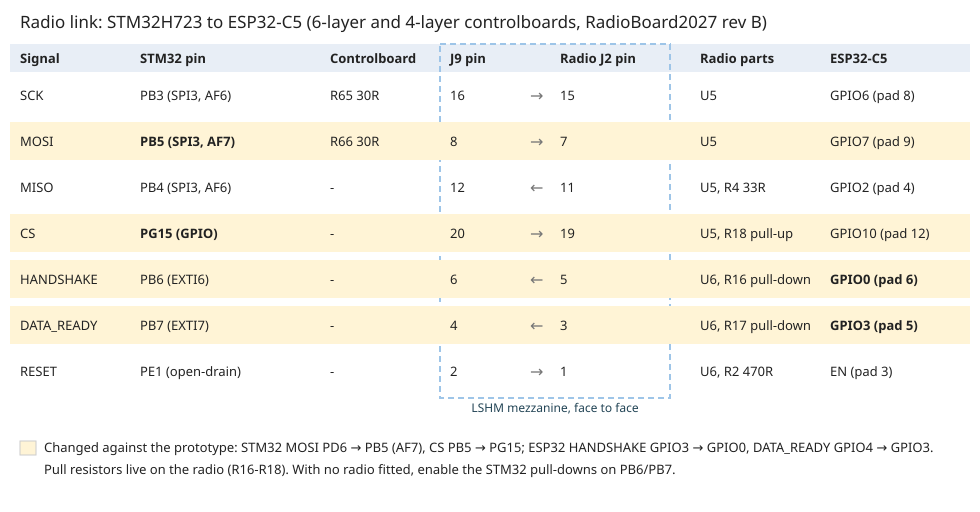

# Firmware changes against the prototype (6-layer and 4-layer boards)

This page is for firmware. It lists every change between the prototype (`../../prototype`) and the new
boards that the code can see:
- ControlBoard2027_6L (`../ControlBoard2027_6L`);
- ControlBoard2027_4L (`../../4layer/ControlBoard2027_4L`);
- RadioBoard2027 rev B (`../RadioBoard2027`, same board in both sets).

The 6-layer and 4-layer controlboards have the **same schematic and the same STM32 pin map**, so one
firmware build runs on both. Everything here was checked against the schematics (netlist diff of U2
and the radio's U1) and the alternate-function table of the STM32H723 datasheet (DS13313).

## 1. STM32H723 (U2) pin map

Pins not listed are unchanged: USB, SWD, LED SPI, motor SPI SCK/MOSI/MISO, IMU I2C, radio
SCK/MISO/HANDSHAKE/DATA_READY/RST, buttons BOOT0/RESET, crystal.

| Function | Prototype | New boards | Notes |
|---|---|---|---|
| Radio SPI MOSI | PD6 (SPI3, AF5) | **PB5** (SPI3_MOSI, **AF7**), pin 135 | Same SPI3; SCK PB3 and MISO PB4 unchanged |
| Radio SPI CS | PB5 | **PG15**, pin 132 | GPIO (software CS) as before |
| SD card | SDMMC1: PC8-PC12, PD2 | **SDMMC2**: PD6 CK (p122), PD7 CMD (p123), PG9-PG12 D0-D3 (p124-127) | Peripheral instance changes; 4-bit bus as before |
| MOTOR0_SPI_CS | PC5 | **PG0** (p56) | |
| MOTOR1_SPI_CS | PB0 | **PG1** (p57) | |
| MOTOR2_SPI_CS | PB1 | **PE7** (p58) | |
| MOTOR3_SPI_CS | PB2 | **PE8** (p59) | |
| DRIBBLER_SPI_CS | PF11 | **PE9** (p60) | |
| DIP0-DIP5 (robot ID) | PF7, PF8, PF9, PF10, PC0, PC1 | **PA0, PA1, PA2, PA3, PA4, PF10** (p34-37, p40, p22) | DIP5 keeps PF10 |
| USER_EXTI0 (BTN0) | PE4 | **PF8** (EXTI8), p20 | |
| USER_EXTI1 (BTN1) | PC13 | **PC15** (EXTI15), p9 | |
| USER_EXTI2 (BTN2) | PC14 | **PE4** (EXTI4), p3 | |
| ACCEL_EXTI (IMU INT1) | PF3 | **PC14** (EXTI14), p8 | |
| GYRO_EXTI (IMU INT2) | PF2 | **PF3** (EXTI3), p13 | |
| PWR_UART (power board) | UART4: PA0 TX, PA1 RX | **USART3, TX/RX swapped**: PB11 (p70) = TX, PB10 (p69) = RX, AF7 | **Set USART_CR2.SWAP = 1** |
| PWR_SRC_5V / PWR_SRC_3V3 | PA2 / PA3 | **PE14 / PE15** (p67 / p68) | Poll these: EXTI14/15 are taken by ACCEL and BTN1 |
| KICKER_I2C | I2C2: PB10 SCL, PB11 SDA | **I2C3**: PA8 SCL (p100), PC9 SDA (p99), AF4 | |
| EXPANSION_I2C | I2C4: PF14 SCL, PF15 SDA | **I2C1**: PB8 SCL (p139), PB9 SDA (p140), AF4 | |
| OLED_I2C | I2C1: PB8 SCL, PB9 SDA | **I2C4**: PF14 SCL (p54), PF15 SDA (p55), AF4 | Expansion and OLED buses swapped peripherals |

**Interrupts.** Every interrupt input now has its own EXTI line:

| EXTI line | Source |
|---|---|
| 3 | GYRO (PF3) |
| 4 | BTN2 (PE4) |
| 6 | radio HANDSHAKE (PB6) |
| 7 | radio DATA_READY (PB7) |
| 8 | BTN0 (PF8) |
| 14 | ACCEL (PC14) |
| 15 | BTN1 (PC15) |

## 2. Pull resistors that moved

| Line | Prototype | New boards | Firmware |
|---|---|---|---|
| Radio CS pull-up | controlboard R29 10k | radio R18 10k | none |
| HANDSHAKE / DATA_READY pull-downs | controlboard R31 100k / R32 10k | radio R16 100k / R17 10k | **With no radio fitted, enable the internal pull-downs on PB6/PB7** so the inputs do not float |
| I2C pull-ups | | OLED bus: R8/R10. Expansion bus: R14/R17. IMU: R7/R9. Kicker: R18/R19 | none (values unchanged) |

## 3. Radio board (ESP32-C5 co-processor), rev B

| Signal | ESP32-C5 GPIO | Module pad | Change |
|---|---|---|---|
| SPI CLK / MOSI / MISO / CS | GPIO6 / GPIO7 / GPIO2 / GPIO10 | 8 / 9 / 4 / 12 | none |
| HANDSHAKE | **GPIO0** | 6 | was GPIO3 |
| DATA_READY | **GPIO3** | 5 | was GPIO4 (GPIO4 now unconnected) |
| Reset | EN | 3 | none |
| PWR_SRC_HOST | GPIO9 | 11 | none |
| Status LED / BOOT | GPIO24 / GPIO28 | 23 / 15 | none |

- ESP-Hosted menuconfig on the radio:
  - CLK 6, MOSI 7, MISO 2, CS 10;
  - **HANDSHAKE 0, DATA_READY 3**;
  - SPI mode 3;
  - checksum on.
- The STM32 side of HANDSHAKE / DATA_READY is unchanged (PB6 / PB7).
- GPIO0 and GPIO3 float during the ESP32's reset (datasheet Table 2-1). R16/R17 hold the lines low,
  and the host should still ignore them for 500 ms after releasing EN.
- GPIO3 is a strapping pin, but it only sets the SDIO clock edge. Boot mode comes from GPIO26-28
  only.

## 4. Things that did not change for firmware

- **LED driver.** U10 now buffers the LED data on gate 2 (it was gate 4). The STM32 pins and the
  DotStar protocol are the same.
  - Chain order: D7 upper right (first after U10), D8 lower right, D9 lower left, D10 upper left,
    D11 centre (last).
- **Debug.** STDC14 (J3) and Tag-Connect TC2070 (J19) carry SWDIO / SWCLK / NRST only. SWO is not
  available because PB3 is the radio SPI clock, as on the prototype.
- **Power-source muxes.** The manual jumpers J14 / J16-J18 are gone. The TPS2116 muxes switch
  automatically and report on PWR_SRC_5V / PWR_SRC_3V3 (new pins above).
- **Connectors.** The motor, expansion, kicker and power-board connectors changed type and pinout (JST
  GH / PH). That is a cable change; the signals are the ones above.

## 5. Bring-up checklist

1. **CubeMX pin changes:**
   - radio MOSI PB5 AF7, CS PG15;
   - SDMMC2 instead of SDMMC1;
   - motor and dribbler CS on PG0, PG1, PE7, PE8, PE9;
   - DIP on PA0-PA4 and PF10;
   - buttons on PF8, PC15, PE4;
   - IMU interrupts on PC14 (ACCEL) and PF3 (GYRO);
   - USART3 on PB10/PB11 with SWAP;
   - PWR_SRC on PE14/PE15;
   - I2C3 for the kicker, I2C1 for the expansion bus, I2C4 for the OLED.
2. **EXTI:** reassign the handlers to lines 3, 4, 6, 7, 8, 14 and 15.
3. **No radio fitted:** enable the PB6/PB7 pull-downs.
4. **Radio firmware:** set HANDSHAKE = GPIO0 and DATA_READY = GPIO3.
