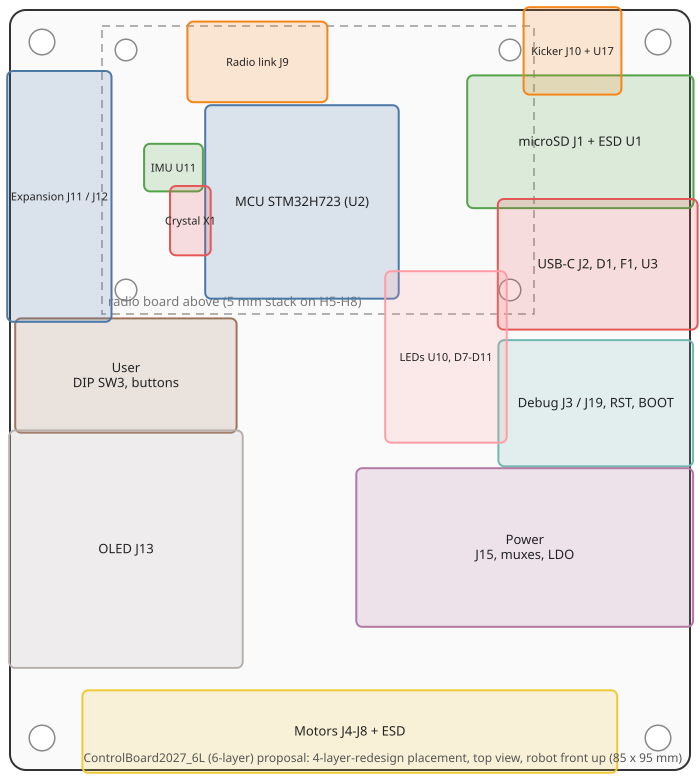
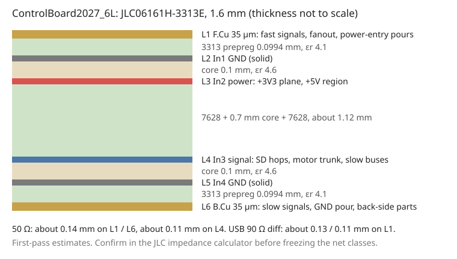

# ControlBoard2027_6L (6-layer) floorplan proposal

Status: **approved and routed**. See [DESIGN_NOTES.md](DESIGN_NOTES.md) for the result, the length table and the deviations.

The 6-layer project started as a copy of an earlier 4-layer redesign of the prototype (since retired) with:
- the same schematic, pin assignments, parts and board outline;
- every track, via and zone removed;
- the 6-layer stackup below.

Placement starts from that 4-layer redesign: the connectors, buttons, LEDs and mounting holes stay where users and the
mechanics expect them. The rest is re-routed for length and impedance matching first.

## 1. Stackup: JLC06161H-3313E (1.6 mm, outer 1 oz, inner 0.5 oz)

| Layer | Use | Dielectric to next layer |
|---|---|---|
| L1 F.Cu | Fast signals, fanout, power-entry pours | 3313 prepreg, 0.0994 mm, εr 4.1 |
| L2 In1 | Solid GND | core 0.1 mm, εr 4.6 |
| L3 In2 | Power plane: +3V3, a +5V region (U8 → U10 and LEDs → expansion fuses), local power-block nets | 7628 + 0.7 mm core + 7628, about 1.12 mm |
| L4 In3 | Inner signal layer: crossings (SD hops), motor trunk, longer slow buses | core 0.1 mm, εr 4.6 |
| L5 In4 | Solid GND | 3313 prepreg, 0.0994 mm |
| L6 B.Cu | Slow signals, GND pour, back-side parts | |

**What this layout gives each layer:**
- Every signal layer sits 0.1 mm from a solid GND plane. L4 references L5, and L1 / L6 reference L2 / L5.
- The 4-layer workaround (GND patches cut into the +3V3 plane) is not needed.
- A layer change needs one GND via (L2-L5 tie) next to it and no stitching cap.
- L3 sits 0.1 mm over L2, so the power plane gets real plane capacitance.

## 2. Net classes (first-pass widths)

These are IPC-2141 estimates. They must be confirmed in the JLC impedance calculator before the net
classes are frozen.

| Class | Layer | Width / gap | Pour clearance (2W) |
|---|---|---|---|
| USB_90R | L1 | 0.13 / 0.11 mm (≈90 Ω diff) | 0.30 mm |
| SIG50 outer | L1 / L6 | 0.14 mm (≈51 Ω) | 0.28 mm |
| SIG50 inner | L4 | 0.11 mm (≈50 Ω, asymmetric stripline) | 0.22 mm |
| Default | any | 0.15 mm | – |
| Power | L1 pours, L3 plane, short tracks ≥ 0.4 mm | – | – |

**What the thinner lines buy:**
- At 0.14 mm the 50 Ω lines fit the 0.5 mm LQFP and J9 pitch with no neck-downs.
- 3W spacing drops from 1.08 mm to 0.42 mm.
- A serpentine fits in 0.42 mm of height, so several lines can meander side by side.

## 3. Matching targets

Tolerances come from v1, which works apart from the SD card, and CLAUDE.md.

| Group | Target | Earlier 4-layer result |
|---|---|---|
| SD (CK, CMD, D0-D3) | all within 0.7 mm (v1) | 7.7 mm |
| Radio SPI (SCK, MOSI, MISO, CS) | data within 0.2 mm of SCK at J9, end-to-end with the radio board ≤ 0.2 mm | MOSI −0.18, MISO 0, CS +0.21 |
| Motor SPI (per connector) | MOSI / MISO within 0.3 mm of SCK, CS within 1 mm | 0.31 mm, CS up to −11.4 mm |
| USB pair | ≤ 0.15 mm per plug orientation where the stubs allow | 2.1 mm |
| LED SPI (U2 → U10 → D7) | within 1 mm | 12.5 mm |

## 4. Routing plan per bus

**SD:**
- The four crossings (D2 over D3, D1 under D0, CMD and CK over D0/D1) become short hops on L4. GND sits
  on both sides there, and each signal via has a GND via beside it.
- Serpentines on L1 bring every line to the longest within 0.7 mm. There is room because the lines
  are 0.14 mm.

**Motor:**
- The 4-layer matched-feed trunk moves to L4: feed vias at the drop-via offsets, constant offset taken out
  by serpentines in the corridor.
- The CS lines get their own serpentines, which now fit.

**Radio:** L1 only, as on the 4-layer redesign, but at full 50 Ω width (0.14 mm). One trapezoid per line where needed.

**USB:**
- L1 only.
- The duplicate-contact join is redone so the two orientations match as closely as the receptacle
  allows: symmetric short stubs to both contact pairs.

**LED SPI:** two options; recommended first.
1. Use U10's spare gate beside the SCK gate. The one crossing it creates is a short L4 hop on the data
   line, and both inputs then come from the same side, so they match.
2. Keep the gates as they are and add serpentine on SCK. This did not fit on the 4-layer redesign either.

**Power:**
- L3 split: a +3V3 main plane and a +5V region. The +5V region covers U8's output, U10, the LED
  cluster and a finger to the expansion fuses.
- The power-entry paths (J15, Q1, F5 / F6, D3 / D4) stay as L1 pours.
- The B.Cu +5V island and the long +5V tracks go.

**Slow nets:**
- L6 first, then L4 where L6 is busy.
- Buttons, DIP, I2C buses, UART, SWD, kicker, expansion.

**Stitching:**
- L2-L5 GND vias on a ≈4 mm grid, and along every L4 run and every board edge.
- A return via within 1 mm of every fast-net layer change.

## 5. Placement changes against the 4-layer redesign

- **Placement:** the 4-layer positions are kept; only the routing changes. The groups were already planned
  around the pin-group map.
- **Vias:**
  - JLC builds 6-layer boards with filled, plated-over via-in-pad at no extra cost. Decoupling caps
    may use via-in-pad, which shortens the loops.
  - The default via drops from 0.3 / 0.6 mm to 0.25 / 0.45 mm.

## 6. Open decisions

1. **Back-side parts.** The 4-layer redesign had 69 footprints on B.Cu (decaps under U2, pull-ups, bulk caps). Moving them
   to the top would allow JLC's Economic (single-side) assembly, about $58 cheaper per order. The cost
   is space on top and longer decap loops at U2. The recommendation is to keep the U2 decaps on the
   back, which forces Standard PCBA, and to accept the cost.
2. **LED SPI gate swap (done).** U10 gate 2 now buffers DATA (gate 4 did before); gates 3 and 4 are
   disabled. Firmware does not change. Both pairs still need one L4 crossing each; see DESIGN_NOTES §3.
3. **Board thickness and finish.** 1.6 mm ENIG (ENIG is free on 6-layer).

Once this is approved: set the net classes and DRC rules, then route the buses in the order USB, SD,
radio, motor, LED. After that come power, slow nets and stitching, then the audits.
