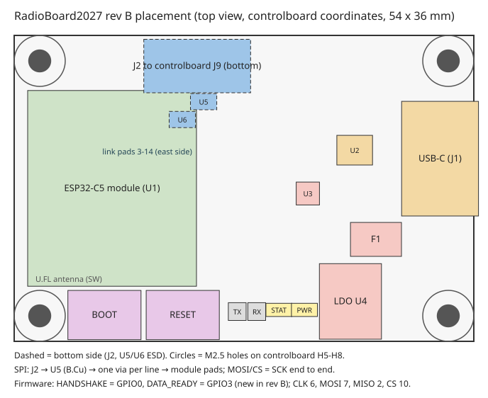
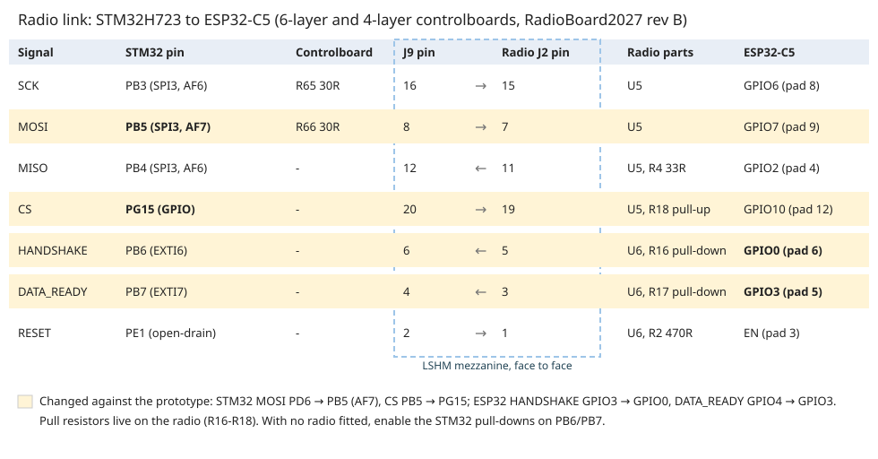

# RadioBoard2027 rev B: radio board for the 6-layer and 4-layer controlboards

The radio board (ESP32-C5 Wi-Fi co-processor, ESP-Hosted over SPI) is re-laid out to sit on
ControlBoard2027_6L (and, unchanged, on ControlBoard2027_4L). The project is `../RadioBoard2027`. The circuit is the prototype's; only the
layout, one ESD channel order and two GPIO assignments change. Design reasoning, the length table
and the deviations are in `../RadioBoard2027/DESIGN_NOTES.md` §7.

## What firmware needs to know

| Signal | ESP32-C5 GPIO | Module pad | Change from the prototype |
|---|---|---|---|
| SPI CLK | GPIO6 | 8 | none |
| SPI MOSI (host → ESP) | GPIO7 | 9 | none |
| SPI MISO (ESP → host) | GPIO2 | 4 (through R4 33 Ω) | none |
| SPI CS | GPIO10 | 12 | none |
| HANDSHAKE | **GPIO0** | 6 | was GPIO3 |
| DATA_READY | **GPIO3** | 5 | was GPIO4 (GPIO4 is now unconnected) |
| Reset | EN | 3 | none |
| PWR_SRC_HOST | GPIO9 | 11 | none |
| Status LED | GPIO24 | 23 | none |

- ESP-Hosted menuconfig must set:
  - CLK = 6, MOSI = 7, MISO = 2, CS = 10;
  - **HANDSHAKE = 0, DATA_READY = 3**;
  - SPI mode 3.
- The STM32 keeps HANDSHAKE / DATA_READY on PB6 / PB7, but the host side of the link did change
  elsewhere:
  - radio MOSI moved PD6 → PB5 (SPI3, AF7);
  - CS moved PB5 → PG15;
  - the pull resistors moved onto the radio.

  The full STM32 and ESP32 change list is in [FIRMWARE.md](FIRMWARE.md).
- Why the GPIOs moved: GPIO4 is on the module's far side from the link connector. With DATA_READY
  there, its line would have had to cross the reset line under the module. GPIO0 and GPIO3 sit on
  the near side, in the connector's order.
- Both pins float during reset (ESP32-C5 datasheet Table 2-1). The radio board's R16 (100 kΩ) and
  R17 (10 kΩ) hold HANDSHAKE and DATA_READY low. The host should still ignore both for 500 ms after
  releasing EN.
- GPIO3 is a strapping pin, but it only selects the SDIO clock edge, which SPI does not use. Boot
  mode is set by GPIO26-28 only.

## Mechanics

- **Size.** 54 × 36 mm, ESP32 module on top, J2 underneath.
- **Mounting.** Four M2.5 × 5 mm standoffs on controlboard H5-H8, and J2 (Samtec LSHM, 5 mm stack)
  on controlboard J9. The mating script confirms all 20 pins land on the right partner pins and
  the holes coincide.
- **Edges.** USB-C is on the east edge, the same side as the controlboard's USB, SD card and debug
  header; the plug clears the controlboard parts under it. RESET and BOOT sit side by side on the
  south edge (hold BOOT, tap RESET for download mode).
- **Antenna.** The U.FL connector is at the module's south-west corner, just above BOOT. Run the
  antenna cable west over the module edge, not across the buttons.
- **Test points.** The TX/RX test points and the STAT/PWR LEDs are in one row along the south edge,
  east of the buttons.

## Link timing

| | SCK | MOSI | CS | MISO |
|---|---|---|---|---|
| Controlboard U2 → J9 (mm) | 6.30 | 6.12 | 6.51 | 6.30 |
| Radio J2 → module (mm) | 19.93 | 20.10 | 19.72 | 23.81 |
| Total (mm) | 26.23 | 26.22 | 26.23 | 30.11 |
| vs SCK (mm) | 0 | −0.00 | +0.00 | +3.88 |

MOSI and CS arrive with SCK. MISO travels back from the ESP32 and is not matched; its extra 3.9 mm
(about 25 ps) is negligible against the 12.5 ns half period at 40 MHz.

## Status (2026-11-04)

- **Checks.**
  - DRC: 0 errors, 0 unconnected, 0 schematic-parity issues.
  - ERC: 0.
  - The custom DRC rules are proven to compile.
- **Audit.** An independent layout audit found no critical issues. The majors are fixed (VBUS TVS at
  the connector, antenna cable routing documented). See DESIGN_NOTES §7.
- **Before ordering.**
  - Order the bottom-side parts with bottom assembly: J2, D4, U5, U6, R2, R18, R3.
  - Confirm the impedance widths in the JLC calculator.
