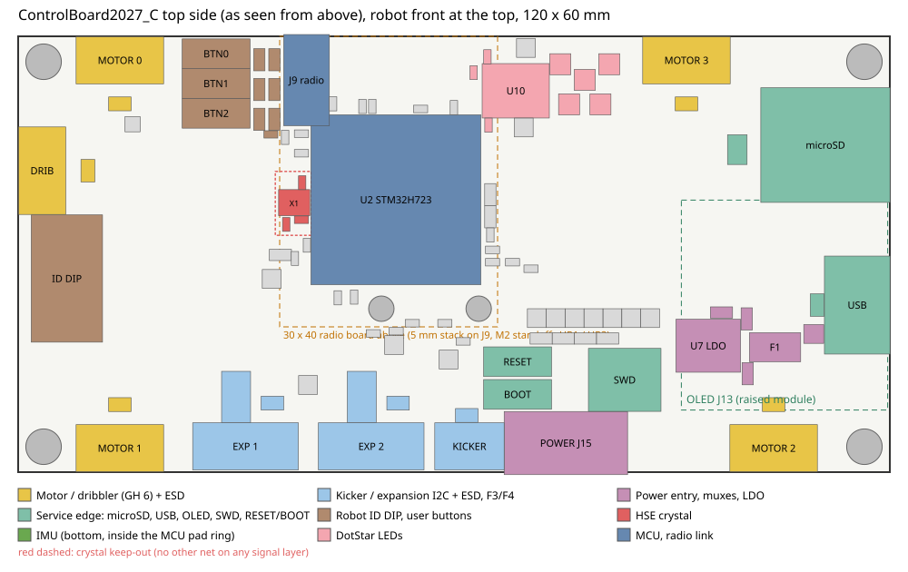
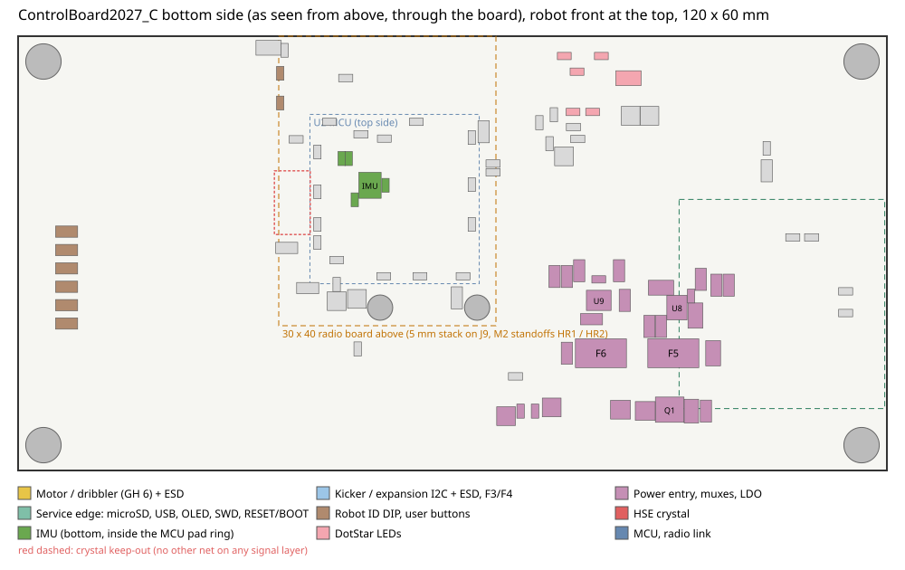

# ControlBoard2027_C design notes

Why each part, value and layout choice on ControlBoard2027_C was made, the measured layout figures, and every known
deviation from the house rules (`../../CLAUDE.md`). The schematic and the board file are the ground truth; where this
file disagrees with them, they win and this file is wrong.

Related documents:
- [../README.md](../README.md): the compact set, status and folder map.
- [../docs/INTERFACE.md](../docs/INTERFACE.md): J9 radio mezzanine, mounting, stack height, and the pinouts of every
  external connector with what the mating board must use.
- [../docs/FIRMWARE.md](../docs/FIRMWARE.md): STM32 pin map, clock tree, peripheral and GPIO settings, bring-up.
- [../docs/PROTOTYPE_TO_COMPACT.md](../docs/PROTOTYPE_TO_COMPACT.md): every change from the prototype board.
- [TODO.txt](TODO.txt): open work.

**Coordinates.** Every position in this file is in mm from the top-left corner of the board outline, x to the right,
y down, seen from the top. The robot front is at the top (y = 0). In the KiCad file the outline corner sits at
(49.475, 49.475), so subtract that from KiCad's absolute coordinates.

**Contents**

1. [Status](#1-status)
2. [Sources](#2-sources)
3. [Board summary](#3-board-summary)
4. [Power](#4-power)
5. [MCU, clock and supply pins](#5-mcu-clock-and-supply-pins)
6. [I2C buses](#6-i2c-buses)
7. [USB and debug](#7-usb-and-debug)
8. [SD card](#8-sd-card)
9. [IMU, DIP switch and buttons](#9-imu-dip-switch-and-buttons)
10. [DotStar LEDs](#10-dotstar-leds)
11. [Connectors](#11-connectors)
12. [PCB layout](#12-pcb-layout)
13. [Deviations from the house rules](#13-deviations-from-the-house-rules)
14. [Open issues](#14-open-issues)
15. [BOM and sourcing](#15-bom-and-sourcing)
16. [Appendix: review history](#appendix-review-history)

---

## 1. Status

State on 2026-11-07, checked on the saved repo files:

| Check | Result |
|---|---|
| ERC | 1 error: the U2 VCAP pin 71 / 106 power-output tie. Intended (§5, m21) |
| DRC (kicad-cli, schematic parity on, zones as saved in the repo file) | 0 errors, 0 unconnected, 0 parity issues, 13 warnings (§12.9) |
| Custom rules | Compile; proved with a deliberately violated test rule (fired 17 times) and a test track in the XTAL area (fired once), both removed |
| Bus lengths | Re-measured 2026-11-07, all groups inside tolerance (§12.5) |
| Independent audits | Three rounds (2026-11-06/07). Round 3 found no critical or major issue (appendix) |
| Fabrication outputs | Not generated for this board |

The 2026-11-07 documentation pass re-ran DRC and the length scripts but did not refill zones. Refill, save and re-run
DRC before generating fabrication outputs (CLAUDE.md §11).

Open before ordering: see [TODO.txt](TODO.txt) "BEFORE ORDERING" and §14 (C1 DotStar footprint view, impedance
confirmation with JLC, re-audit of the last changed areas, mating-board agreements).

---

## 2. Sources

| Tag | Document |
|---|---|
| DS13313 | STM32H723 datasheet |
| AN5419 | STM32H723/733 hardware development, Rev 3; SDMMC routing §9.4.1 |
| AN2606 | STM32 system bootloader, Rev 61, STM32H72x section (Tables 111 / 112) |
| SLVSFG1A | TI TPS2116 power mux |
| DS22057B | Microchip MCP1826/MCP1826S 1 A LDO, Rev B (ww1.microchip.com/downloads/en/DeviceDoc/22057B.pdf) |
| DS37274 | Diodes AP7361C LDO (the `MPN_ALT` alternate for the LDO) |
| TVS0500 | TI TVS0500 flat-clamp TVS |
| AO3401A | AOS AO3401A P-FET |
| MF-MSMF | Bourns MF-MSMF PTC, Rev BD 06/26 |
| 1812L | Littelfuse 1812L PTC (07/21/17), the JLCPCB-build fuses |
| SCLS264R | TI SN74AHCT125 |
| DS14623 | ST LSM6DSV320X datasheet, Rev 3 (fitted U11) |
| DS15060 | ST LSM6DSK320X datasheet, Rev 1 (the original U11 choice; same pin table and ranges) |
| AN6119 | ST LSM6DSV family application note (pin 1 / CS / aux-pin entries) |
| BB2020 | American Bright BB-2020BGR-TRB |
| ABM8 | Abracon ABM8 crystal |
| SLVA689 | TI I2C pull-up resistor calculation |
| SLVSBO7O | TI TPD4E05U06 / TPD6E05U06, including layout guidance |
| JLC06161H-3313E | JLCPCB 6-layer 1.6 mm impedance-controlled stackup |
| USB 2.0 | USB 2.0 specification plus the VBUS Max Limit and Device Capacitance ECNs |
| Type-C | USB Type-C specification |
| LSHM | Samtec LSHM product specification and recommended layout rev G |
| SSD1306 | Solomon Systech SSD1306 |
| ESP32-C5 | Espressif ESP32-C5 and ESP32-C5-WROOM-1 / -1U datasheets |
| ESP-Hosted | Espressif esp-hosted-mcu, SPI full-duplex design |
| V0.3 | ControlBoard_TestingV0.3 CubeMX report and clock tree (the old firmware project) |

Footprint evidence for the project-library parts: `footprints/FOOTPRINT_SOURCES.md`. The datasheet PDFs referenced
there are kept with the prototype project (`../../prototype/ControlBoard2027/datasheets/`).

---

## 3. Board summary

- 120 x 60 mm, 6 layers (JLC06161H-3313E, 1.6 mm), four M3 corner holes H1-H4 at (3.5, 3.5), (116.5, 3.5),
  (3.5, 56.5), (116.5, 56.5).
- STM32H723ZGT6 (LQFP-144) at (52.0, 22.5), rotation 0 (pin 1 north-west).
- 30 x 40 mm radio board (RadioBoard2027_C_Inboard or _Overhang, one shared interface) stacked 5 mm above the MCU on
  J9 (Samtec LSHM, (39.70, 6.03), rotation 90) and two M2 standoffs HR1 (50.0, 37.5) / HR2 (63.4, 37.5). Radio
  outline x 36-66, y 0-40. Details: [INTERFACE.md](../docs/INTERFACE.md).
- Power from the powerboard on J15 (JST PH 7P: +5V and +3V3 rails, UART); USB-C J2 as a bench fallback with
  automatic priority switching (TPS2116 muxes).
- Four wheel motors and a dribbler on three SPI buses (JST GH 6P), kicker I2C (GH 4P), two expansion I2C ports with
  fused 5 V (GH 8P), microSD (SDMMC2, 4-bit), raised 0.96in OLED (I2C), LSM6DSV320X IMU, five DotStar LEDs, 6-bit
  robot-ID DIP, three user buttons, RESET and BOOT0 buttons, STDC14 SWD.

---

## 4. Power

### 4.1 Rails

| Rail | Source | Loads |
|---|---|---|
| +5V_RAW | J15 pin 6 | Q1 (reverse polarity) |
| +5V_PROT | after Q1 | D3 TVS, F5 |
| +5V_PB | after F5 | U8 VIN1 / MODE |
| +3V3_RAW | J15 pin 4 | D4 TVS, F6 |
| +3V3_PB | after F6 | U9 VIN1 / MODE |
| VBUS | USB J2 after F1 | U8 VIN2, U7 LDO, R20 / R21 sense divider |
| +3V3_LDO | U7 from VBUS | U9 VIN2 |
| +5V | U8 output (powerboard, else USB) | DotStars, U10, F3 / F4 (J11 / J12 feeds) |
| +3V3 | U9 output (powerboard, else USB) | MCU, SD, IMU, OLED, pull-ups, radio (J9) |

The motor connectors J4-J8 and the kicker connector J10 carry signals and GND only; those boards are powered by the
powerboard. The radio and the DotStars run from the mux outputs, so both also work on USB alone; firmware caps LED
brightness on USB (§10). Wi-Fi TX adds up to about 0.4 A of peaks to the USB budget (m22).

Protection is a TVS and a PTC fuse on each input. There are no eFuses: no undervoltage lockout, no overvoltage
clamp, no fast current limit, no fault signal and no USB inrush limit (M1, M3, m18).

### 4.2 J15 powerboard input

JST PH S7B-PH-K-S (right angle, 7-pin, 2.00 mm): 1 PWR_UART_TX (out of this board), 2 PWR_UART_RX (into this
board), 3 GND, 4 +3V3_RAW, 5 GND, 6 +5V_RAW, 7 GND. RX / TX are named from this board's side; the full mating
rule is in [INTERFACE.md](../docs/INTERFACE.md). GND pin 5 sits between the two rails, so a one-pin crimp shift
cannot short +5V to +3V3. Each PH contact is rated 2 A, one contact per rail (deviation 17).

R33 (TX) and R34 (RX), 1k, sit in series between J15 pins 1 / 2 and PA0 / PA1 (UART4, 115200, 3.3 V logic), on the
bottom in line with the pins. TP10 / TP11 sit on their MCU-side pads. Reasons (DS13313 Rev 4):
- Unpowered powerboard: if its RX pin clamps to its own VDD, PA0 high feeds at most (3.3 - 0.6) V / 1k = 2.7 mA into
  that rail instead of back-powering it.
- Cable faults: TX shorted to GND or +5 V is held to 3.3 mA or 1.7 mA, well below the 20 mA per-pin limit
  (Table 10, I_IO).
- Injection: Table 10 allows -5 / +0 mA on FT pins, but Table 50 rates PA0 / PA1 (FT_ha) at 0 mA functional
  susceptibility, so cable ringing below GND must be damped and limited.
- Unpowered MCU: PA1 is 5 V tolerant with VDD off (Table 9), so a powerboard TX into an unpowered control board is
  not a damage path.
- Timing: 1k with about 100 pF of cable and pin gives tau = 100 ns, about 1 % of a 115200 bit.

### 4.3 Q1 reverse polarity (5 V only)

AO3401A P-FET: -30 V, -4 A, Vgs abs max +-12 V. Drain to the input, source to the load, gate to GND through R35
100k; D2 (BZX384-C10, 10 V zener) keeps Vgs inside +-12 V. RDS(on) <= 60 mohm at -4.5 V, 135 mW at 1.5 A. The 3V3
input has no series FET: its drop would take the radio below 3.0 V (M2).

### 4.4 D3 (5 V), D4 (3V3) input TVS

TVS0500DRV on both inputs: VRWM 5 V, VBR 7.5-8.4 V, flat clamp 9.2 V at 43 A. They take surge and ESD only; their
clamp is above the TPS2116 6 V abs max, so the powerboard must regulate (M1). D4 sits directly on +3V3_RAW at J15.
D3 sits after Q1 (+5V_PROT), not before it: the TVS0500 is unidirectional and would conduct on a reversed input before
Q1 could block it.

### 4.5 F5 (5 V) and F6 (3V3) fuses

Value "PTC 1.25A 1812". Bourns MF-MSMF125/16X-2 (alternate) or Littelfuse 1812L125/16DR (JLCPCB build): hold 1.25 A /
trip 2.50 A at 20-23 °C, 1.00 A hold at 40 °C, 0.95 A at 50 °C, 0.04-0.14 ohm, max 0.4 s to trip at 8 A, 16 V. The
sizing below applies to both.

The trip current equals the TPS2116's 2.5 A rating, so the fuse opens before the mux is overloaded. It is above the
2 A of the single J15 contact per rail (deviation 17, M3). The powerboard must source more than 2.5 A per rail into a
fault, or its own current limit acts first.

| Rail load | +5V | +3V3 |
|---|---|---|
| DotStars (capped by firmware, §10) | 250 mA | - |
| Motor modules J4-J8, kicker J10 | 0 (no supply pins) | 0 |
| J11 / J12 via F3 / F4 | 0.55 A combined allocation at 50 °C | - |
| Radio (TX peak) | - | 403 mA peak |
| MCU, SD, IMU, OLED | - | about 0.35 A |
| Fuse hold at 50 °C | 0.95 A | 0.95 A |

A PTC is slow: current between hold and trip can flow indefinitely. 3V3 drop: 0.14 ohm x 1 A = 0.14 V worst case
(M2). No fault output.

### 4.6 U8 (5 V) and U9 (3V3) TPS2116 muxes

Priority mode (MODE tied to VIN1). VIN1 is the powerboard rail, VIN2 the USB side. VREF is 0.92 / 1.00 / 1.08 V with
no built-in hysteresis. There are no power jumpers: the mux inputs and outputs are wired directly, so a failed
TPS2116 has to be replaced.

| | U8 5V | U9 3V3 |
|---|---|---|
| PR1 divider | R36 100k / R37 36k | R38 100k / R39 68k |
| Hysteresis | R40 1M from ST | R41 1M from ST |
| Switchover (VREF typ) | about 3.55 V falling / 3.88 V rising | about 2.34 V falling / 2.57 V rising |

- ST is open drain. R42 / R43 10k pull it up to 3V3. PWR_SRC_5V goes through R44 10k to PA2; PWR_SRC_3V3 goes to PA3.
  High means the powerboard is selected.
- R44: ROM bootloaders before V9.3 drive USART2 TX (PA2) push-pull (AN2606 V9.3 note). With USB power ST is low and
  R44 limits the contention to 0.33 mA.
- While VIN1 is selected it stays tied to VOUT until PR1 drops below VREF (SLVSFG1A §7.6.1). With USB attached and the
  powerboard removed, the rail sags to the switchover voltage first (M7).
- C33 22 uF (5 V) and C34 10 uF (3V3) at VIN1; C35 2.2 uF (5 V, on VBUS) and C36 2.2 uF (3V3) at VIN2; C37 / C38
  22 uF and C39 / C40 100 nF at the outputs.
- No diodes on the outputs: the TPS2116 disconnects an input once VOUT exceeds it by 42 mV (SLVSFG1A §7.3.4), so the
  powerboard cannot back-feed USB and USB cannot back-feed the powerboard.
- Footprint `ControlBoard2027:TI_TPS2116_DRL0008A`: extended 1.00 x 0.30 mm pads for hand soldering, paste apertures
  as TI's land pattern.

### 4.7 USB VBUS input and U7 LDO

VBUS from J2 goes through D1 (TVS0500DRV, at J2, before F1) and F1 to U8 VIN2, U7 and the R20 / R21 sense divider.
- F1 "PTC 0.75A 1812" (Bourns MF-MSMF075/16X-2 or Littelfuse 1812L075/24DR): hold 0.75 A / trip 1.50 A at 20-23 °C,
  0.55 A hold at 50 °C, max 0.2 s at 8 A.
- VBUS capacitance: C30 2.2 uF + C31 4.7 uF (U7 input) + C35 2.2 uF = 9.1 uF nominal, inside the USB 10 uF limit.
  Everything behind the muxes still charges from VBUS at attach (m18).
- With the cable out, R20 / R21 (115k total) pull VBUS to 0 V, so U8 VIN2 does not float.
- U7 Microchip MCP1826S-3302E/DB (LCSC C638624, DS22057B): 3.3 V +-2.5 %, 1 A, VIN 2.3-6.0 V (6.5 V absolute
  maximum; USB VBUS is at most 5.25 V), dropout 400 mV max at 1 A, quiescent current 120 uA typ / 220 uA max. The
  3-pin SOT-223 part has no SHDN, PWRGD or sense pin. Pinout 1 VIN, 2 GND (tab), 3 VOUT, the same as the
  AP7361C-33E-13 it replaces (out of stock everywhere on 2026-11-07; kept as `MPN_ALT`; the AP7361C-33ER has a
  reversed pinout and does not fit). Microchip's land pattern (1.90 x 0.95 mm leads at 6.10 mm, 1.90 x 3.25 mm tab,
  2.30 mm pitch) lies inside the `SOT-223-3_TabPin2` pads (2.0 x 1.5 mm at 6.30 mm, 2.0 x 3.8 mm tab).
- U7 capacitors: C31 4.7 uF in; C32 10 uF + C36 2.2 uF out (12.2 uF nominal on the LDO pin). The datasheet asks for
  >= 1 uF ceramic on the output and recommends at most 22 uF (DS22057B §4.3), and an input capacitor at least as
  large as the output capacitor for load steps (§4.4). C31 is smaller than that because VBUS must stay under the
  USB 10 uF limit. The +3V3 bulk (about 77 uF) sits behind the U9 switch, not on the LDO pin; check the switchover
  transient on the bench (TODO 2.2).
- U7 load and heat: on USB alone it carries about 0.35 A plus up to 0.4 A of radio TX peaks. Dissipation is
  (5.0 - 3.3) x 0.35 = 0.60 W (0.68 W at 5.25 V); a 0.75 A peak gives 1.28 W (1.46 W at 5.25 V). With the SOT-223
  theta-JA of 62 °C/W (JEDEC 4-layer board, DS22057B) the junction rises 37-42 °C at 0.35 A. A sustained 0.75 A
  would add 79-91 °C (thermal shutdown at 150 °C, 125 °C operating limit), but TX peaks are short bursts and USB
  power is bench-only (m22). Dropout at 0.75 A is at most about 0.3 V (400 mV at 1 A), so 3.3 V holds down to a
  VBUS of about 3.6 V.

### 4.8 Rail LEDs and test points

D5 / D6 Kingbright APT1608EC red: R45 3.3k gives 0.9 mA on 5 V, R46 1.5k 0.87 mA on 3V3. Test points are 1.5 x 1.5 mm
pads (TP6 is a 1.0 mm round pad), labelled on the silkscreen with their signal names. Power test row at y 38.8:
TP12 GND, TP14 +3V3_RAW, TP13 +5V_PROT, TP17 +3V3, TP15 +3V3_LDO, TP16 +5V; TP3 VBUS at (87.0, 38.8). They measure
the fuse plus mux drop on each rail and the USB side. TP10 (PB_TX) / TP11 (PB_RX) give logic-analyser access to the powerboard UART.

---

## 5. MCU, clock and supply pins

U2 STM32H723ZGT6, LQFP-144, LDO supply only (the H723 has no SMPS; PWR_LDO_SUPPLY in CubeMX). Pin map, clock tree
and peripheral settings: [FIRMWARE.md](../docs/FIRMWARE.md).

### 5.1 Why an external 25 MHz crystal

USB full speed needs 12 Mb/s +-0.25 % (USB 2.0 §7.1.11), and the same PLL output clocks SDMMC and SPI.
- HSI48 alone is +-1.04 % untrimmed (DS13313 Table 35). CRS trimming needs USB SOF packets and does nothing for SPI
  or SDMMC.
- ABM8-25.000MHZ-10-B1U-T (alternate) / -10-D1G-T (JLCPCB build): CL 10 pF, ESR 50 ohm max, C0 3 pF max, 100 uW max
  drive; about 22-27 ppm worst case, far inside the 2,500 ppm USB budget.
- 25 MHz rather than 48 MHz: start-up is guaranteed only below Gmcritmax 1.5 mA/V (DS13313 Table 33).
  gm_crit = 4 x ESR x (2 pi F)^2 x (C0 + CL)^2 is 0.83 mA/V typ, 1.08 mA/V worst at 25 MHz, 2.15 mA/V at 48 MHz.

C18 / C19 12 pF C0G: CL = (12 + 5) x (12 + 5) / 34 + 1-2 pF board = 9.5-10.5 pF with 5 pF pin capacitance. R12 (0R)
in series with OSC_OUT (PH1): the drive estimate is 53 uW at 1.0 Vpp but 103 uW at 1.4 Vpp; measure and fit a few
hundred ohms if needed (m9).

### 5.2 Supply pins

- One 100 nF at each of the 11 VDD pins and VBAT (C3, C4, C6, C8-C10, C12, C14-C17, C21); C5 10 uF and C7 4.7 uF bulk.
- C11 4.7 uF + C13 100 nF at VDD33USB (pin 95).
- VDDA (pin 33) and VREF+ (pin 32) go straight to +3V3 without a ferrite, as on the Nucleo: C24 1 uF + C25 100 nF at
  VDDA, C26 1 uF + C27 100 nF at VREF+.
- PDR_ON (pin 143) to +3V3 enables the internal reset. VBAT (pin 6) to +3V3, no battery.
- VCAP pins 71 and 106 are joined, with C22 / C23 2.2 uF X7R. DS13313 Table 14 note 3 treats them as one node and the
  Nucleo ties them. KiCad ERC flags the tie because the symbol types both pins as power output (m21).
- Layout: the 100 nF caps sit on the bottom behind their VDD / VSS pin pair, each with its own +3V3 and GND via; the
  middle of the QFP is fanout only. The schematic text labels pair some 100 nF caps with different pins than the board
  does (m26); every supply pin still has its own 100 nF.

### 5.3 Reset and boot

- R11 10k BOOT0 pull-down: 0.15 V at worst-case leakage against a 0.73 V input-low limit. SW2 (BOOT) pulls BOOT0 to
  3V3 for the ROM DFU.
- NRST: internal 30-50k pull-up (DS13313 Table 57) and C20 100 nF; no external pull-up. SW1 (RESET) pulls it low.
- R13 10k pull-up on PA15: the bootloader runs SPI3 as a slave on PC10-PC12 (unconnected here) with NSS on PA15 and no
  pull (AN2606 Table 111). Holding NSS high keeps it from selecting SPI3 instead of USB DFU.

### 5.4 Series resistors and sense divider at the MCU

- 30R source-damping resistors, each within 5 mm of its MCU pin: R15 / R16 (SPI1 SCK / MOSI, PA5 / PA7), R67 / R68
  (SPI2, PB13 / PB15), R70 / R71 (SPI4, PE2 / PE6), R65 / R66 (radio SPI3 SCK / MOSI, PB3 / PB5), R6 (SDMMC_CK, PD6).
  MISO lines have none (the far-end driver owns them; the radio MISO is terminated on the radio board, R4 33R).
  DS13313 gives VOL / VOH at a test current, not an output impedance: 0.4 V at 8 mA bounds it at 50 ohm or less, and
  typical HIGH / VERY_HIGH drivers are about 20-30 ohm (an estimate; check against ST's IBIS model). With 30R the
  driver plus R is about 50-60 ohm against Z0 = 50 ohm: slightly overdamped, monotonic edges. These are damping values,
  not proven matches; qualify on the first board.
- R20 47k / R21 68k divide VBUS to PA9 (ratio 0.591): 2.60 V at 4.4 V VBUS (input-high 2.31 V), 3.10 V at 5.25 V;
  the pin's 4.0 V abs max with VDD off is reached only at 6.77 V VBUS.

---

## 6. I2C buses

All buses run at 400 kHz, one pull-up pair per bus on sheet 02.

| Bus | Pins | Pull-ups | Load |
|---|---|---|---|
| IMU (I2C5) | PF0 SDA / PF1 SCL | R9 / R7 2.2k | U11, on board |
| Kicker (I2C2) | PB11 SDA / PB10 SCL | R19 / R18 2.2k | J10, cable; U17 ESD |
| Expansion (I2C4) | PF15 SDA / PF14 SCL | R8 / R10 2.2k | J11 and J12 share it; U6 / U16 ESD |
| OLED (I2C1) | PB9 SDA / PB8 SCL | R17 / R14 2.2k | J13 module (its own pull-ups add in parallel) |

Fast mode allows 300 ns rise time. For 3 mA sink at 0.4 V, SLVA689 gives Rp(min) = (3.6 - 0.4) V / 3 mA = 1.067k and
tr = 0.8473 x Rp x Cb, so 2.2k allows about 153 pF. A typical module pull-up of 4.7-10k in parallel gives 1.5-1.8k,
still above Rp(min). Measure SCL rise time at TP7 (kicker) and TP8 (expansion) with real cables; change to 1.5k
(236 pF budget) only if it exceeds 300 ns. Expansion and kicker boards must not add their own pull-ups to more than
3.3 V (m5).

---

## 7. USB and debug

- J2 GCT USB4110-GF-A, USB 2.0 Type-C, receptacle face flush with the right board edge; shield to GND. R23 / R22 5.1k
  Rd on CC1 / CC2 (sink).
- U3 TPD4E05U06DQA, four flow-through channels, one per data contact (B6, A7, A6, B7); no rail pin, so nothing
  back-feeds VBUS. The duplicate contacts join on the MCU side of U3 (deviation 3).
- No series resistors on D+ / D-: the STM32 full-speed driver is already 28-44 ohm. 90 ohm pair on L1, 0.14 / 0.15 mm,
  matched 0.000 mm in both plug orientations (§12.5).
- Full Speed only (OTG_HS in FS mode). The ROM DFU uses HSI48 with CRS, so it needs neither the crystal nor VBUS sense.
- USB bus-powered operation is restricted to bench use (m22): estimated concurrent load about 0.85 A against F1's
  0.55 A hot hold. Use the powerboard for full operation.
- J3 SWD: ST STDC14 (Samtec FTSH-107-01-L-DV-K, 2 x 7, 1.27 mm, keyed SMD) for the STLINK-V3 14-pin cable, drawn
  with KiCad's official `Connector:Conn_ST_STDC14` symbol. Wired
  pins: 3 +3V3 (VCC sense), 4 SWDIO, 5 GND, 6 SWCLK, 7 GND, 11 GND (GNDDetect), 12 NRST; pins 1, 2, 8, 9, 10, 13, 14
  are not connected (8 would be SWO, but PB3 is the radio SCK). No series resistors on SWD (AN5419 does not require
  them); use a short cable and start at 1 MHz. No protection against a 5 V probe (m14).

---

## 8. SD card

- J1 Hirose DM3AT-SF-PEJM5 push-push microSD (KiCad footprint), shell to GND. The card-detect switch is unused;
  firmware finds a card by initialising it.
- SDMMC2, 4-bit: PD6 CK, PD7 CMD, PG9-PG12 D0-D3.
- R1-R5 47k pull-ups on DAT0-3 and CMD (SD range 10-100k): idle high at least 2.79 V against 2.06 V (card) and 2.31 V
  (MCU) thresholds. CLK has none.
- R6 30R in series with CK at the MCU (§5.4).
- U1 TPD6E05U06RVZR on CLK (card side of R6), CMD and DAT0-3, at J1: VRWM 5.5 V, 0.47 pF per line. Its NC pads are
  tied to the opposite I/O pads in the schematic so each line passes straight through.
- C1 10 uF + C2 100 nF at the card supply. Card VDD is not switchable (M18).
- All six lines are 50 ohm (0.15 mm L1 / 0.12 mm L4) over solid GND, matched within 0.27 mm (§12.5). AN5419 Rev 3
  §9.4.1 asks for 50 ohm +-10 %, under 10 mm skew and under 120 mm before termination. Kernel PLL1Q 48 MHz: CLKDIV 3
  (8 MHz) for bring-up, CLKDIV 1 (24 MHz) after checking CK at TP1. Qualify read and write edges on the first board;
  add damping on CMD / DAT only if the measurement asks for it.

---

## 9. IMU, DIP switch and buttons

### 9.1 U11 LSM6DSV320X

ST LSM6DSV320XTR, LGA-14L 2.5 x 3.0 mm: low-g accelerometer (+-16 g), high-g accelerometer (+-32 to +-320 g) and a
+-4000 dps gyroscope. It replaced the out-of-stock LSM6DSK320X (same pins, package, supply and full scales; the DSK
adds enhanced vibration immunity, which the DSV does not claim).

I2C target mode:
- CS (12) to VDDIO selects I2C. SDO/TA0 (1) to GND gives address 0x6A.
- SDx / SCx (2 / 3) to GND (controller interface unused); OCS_aux / SDO_aux (10 / 11) open (internal pull-ups).
- SCL (13) / SDA (14) on I2C5 with R7 / R9 2.2k. C48 100 nF at VDDIO (5), C49 100 nF at VDD (8).
- INT1 (4) -> ACCEL_EXTI (PF3), INT2 (9) -> GYRO_EXTI (PF2). Both are push-pull and driven low from power-up, so no
  pulls. The part has no reset pin (m16).
- Pinout verified against DS14623 Rev 3 Table 2 (local copy prototype/ControlBoard2027/datasheets/LSM6DSV320X.pdf),
  I2C mode 1, all 14 pins: 1 SDO/TA0 = GND (address 1101010b = 0x6A), 2 SDx / 3 SCx = GND ("connect to VDDIO or
  GND"), 4 INT1, 5 VDDIO = +3V3, 6/7 GND, 8 VDD = +3V3 (1.71-3.6 V), 9 INT2, 10 OCS_aux / 11 SDO_aux open ("connect
  to VDDIO or leave unconnected"; internal pull-ups on by default), 12 CS = +3V3 (I2C enabled), 13 SCL, 14 SDA.
  Footprint pad numbering (1-4 left, 5-7 bottom, 8-11 right, 12-14 top, top view) matches the datasheet pin figure.

Placement: on the bottom, inside the MCU pad ring, at (48.6, 20.6), rotation 270; pin 1 at (47.85, 19.44), the
north-west corner seen from above (deviation 5). Firmware must derive the axis remap from the datasheet axis drawing,
mirrored for the bottom side (FIRMWARE.md).

### 9.2 SW3 DIP switch (robot ID)

Six positions on PF7-PF10, PC0, PC1 (DIP0-DIP5); a closed switch reads 0. R53-R58 100k pull-ups: 33 uA per closed
switch, worst-case high 3.28 V with +-250 nA leakage (DS13313 Table 51) against a 2.31 V threshold. Read at boot.
CTS 209-6MS (alternate) / Hroparts DS-06BP (JLCPCB build), THT, 2.54 mm pitch, 7.62 mm rows; pins 1-6 DIP0-DIP5, 7-12
GND.

### 9.3 SW4-SW6 user buttons

Active low on PE4 / PC13 / PC14 (USER_EXTI0-2). R59-R61 10k pull-ups, R62-R64 10k series, C50-C52 100 nF at the MCU
pin.

| | Path | Nominal | 1 % R, 10 % C |
|---|---|---|---|
| Press | C discharges through R62: tau = 10k x 100 nF | 1.0 ms | 0.89-1.11 ms |
| Release | C charges through R59 + R62: tau = 20k x 100 nF | 2.0 ms | 1.78-2.22 ms |

Firmware ignores re-triggers for about 10 ms. SW1, SW2, SW4-SW6 are APEM MJTP1243 (alternate) / C&K PTS636SM43LFS
(JLCPCB build) 6 x 3.5 mm THT tactiles in the same footprint.

---

## 10. DotStar LEDs

- Five BB-2020BGR-TRB (APA102-2020 compatible) D7-D11 on +5V (the U8 output, so they work on USB too): VDD 4.5-5.5 V,
  input high 0.7 x VDD = 3.5 V, under 10 MHz clock, 70 °C max ambient. The power-on state is not specified: firmware
  sends an all-off frame first.
- Current: up to 500 mA at full white. Firmware caps it at about 250 mA on the powerboard (inside F5's hold, §4.5)
  and about 100 mA on USB (PWR_SRC_5V low). On USB, +5V can sit below 4.5 V, so colours are guaranteed only on the
  powerboard.
- Footprint `ControlBoard2027:AmericanBright_BB-2020BGR-TRB`, built from the BB2020 p2 pad diagram (the stock
  APA102-2020 footprint would put CO on +5V and CI on GND). Top view assumed: C1.
- U10 SN74AHCT125DR (SOIC-14) shifts 3.3 V to 5 V; AHCT has TTL thresholds (VIH 2.0 V), AHC would need 3.5 V.
  Gate 1 buffers LED_SPI_SCK (2 -> 3 -> D7 CKI), gate 4 LED_SPI_MOSI (12 -> 11 -> D7 SDI); gates 2 / 3 disabled (OE to
  +5V, inputs to GND). 6.5 ns max delay, 2 % of the 320 ns bit at 3.125 Mbit/s. Inputs rated -0.5 to 7 V regardless of VCC.
- R48 (SCK) / R47 (MOSI) 100k pull-downs hold U10's inputs low while the MCU pins are Hi-Z at reset (AHCT has no bus
  hold).
- C41 and C43-C47 100 nF (U10 and each LED), C42 22 uF where +5V enters.
- TP18 / TP19 at D7 SDI / CKI and TP20 / TP21 at D11 SDO / CKO separate an upstream fault from a broken chain. Use
  5 V-tolerant probes.
- Layout: D11 at the centre (78.0, 6.0), D7-D10 around it in the robot-shell pattern (chain D7 to D11), U10 at
  (68.5, 7.5) just east of the radio.

---

## 11. Connectors

Pinouts, mating rules and the mating-board requirements are in [INTERFACE.md](../docs/INTERFACE.md). Summary:

| Ref | Function | Part | Notes |
|---|---|---|---|
| J1 | microSD | Hirose DM3AT-SF-PEJM5 | Right edge, under the OLED |
| J2 | USB-C (DFU, bench power) | GCT USB4110-GF-A | Right edge, under the OLED |
| J3 | SWD | Samtec FTSH-107-01-L-DV-K (STDC14) | (83.5, 47.3) |
| J4 / J5 | MOTOR 0 FL / MOTOR 1 BL (SPI1) | JST SM06B-GHS-TB | Front-left and back-left corners |
| J6 / J7 | MOTOR 2 BR / MOTOR 3 FR (SPI2) | JST SM06B-GHS-TB | Back-right and front-right |
| J8 | DRIBBLER (SPI4) | JST SM06B-GHS-TB | Left edge |
| J9 | Radio mezzanine | Samtec LSHM-110-02.5-L-DV-A-S-K-TR | (39.70, 6.03) rotation 90, paste-in-hole shield pins |
| J10 | KICKER I2C | JST SM04B-GHS-TB | Back edge, signals only |
| J11 / J12 | EXP 1 / EXP 2 I2C + fused 5 V | JST SM08B-GHS-TB | Back edge |
| J13 | OLED | BOOMELE 2.54-1*4P socket | Raised module over the right edge |
| J15 | POWER (powerboard) | JST S7B-PH-K-S | Back edge |

- **Motors (J4-J8).** Pinout 1 MOSI, 2 GND, 3 MISO, 4 SCK, 5 GND, 6 CS, tabs GND. SPI only, no supply. Each has its
  own flow-through TPD4E05U06 (U4 J4, U5 J5, U12 J6, U13 J7, U14 J8) with channels in connector-pin order (MOSI 1->10,
  MISO 2->9, SCK 4->7, CS 5->6). R24-R28 10k CS pull-ups hold the modules deselected through reset; R30 / R69 / R72
  100k pull SPI1 / SPI2 / SPI4 SCK down. TP4 / TP5 / TP6 on SPI1 SCK / MOSI / MISO. All five modules share MISO per
  bus (M9). The motor-module board does not yet use this connector (M19). The motor numbering (counter-clockwise from
  front-left: 0 FL, 1 BL, 2 BR, 3 FR) is an assumption; firmware only sees CS pins.
- **Kicker (J10).** 1 SDA, 2 GND, 3 SCL, 4 GND, tabs GND; no power (the kicker is powered by the powerboard). U17 takes
  SDA on channel 1 (1 -> 10) and SCL on channel 3 (4 -> 7) so both lines enter it straight from J10.
- **Expansion (J11 / J12).** 1-2 GND, 3-4 +5V_EXT1 / +5V_EXT2, 5 GND, 6 SCL, 7 GND, 8 SDA. U6 (J11) and U16 (J12)
  flow-through ESD. F3 (J11) and F4 (J12), "PTC 0.75A 1812", each fed from +5V: a tripped port does not unpower the
  other, but the 0.55 A combined allocation (M3) still applies, PTC selectivity is not guaranteed, and an I2C short on
  one port still blocks both.
- **OLED (J13).** Generic 0.96in 128x64 SSD1306 I2C module on a 1x4 2.54 mm socket: 1 GND, 2 +3V3, 3 SCL, 4 SDA.
  The footprint has four 2.6 mm holes for M2 nylon standoffs under the module corners, at (94.8 / 116.2, 25.5 /
  48.5). Address 0x3C (some modules 0x3D). The module is not a BOM line; check its pin order before fitting (some
  modules swap VCC and GND) and its standoff hole positions (M5). The module stands over J1 / J2 / U3 / U7 / U12 /
  D1 / F1 / C30-C32; keep the socket tall enough to clear them. The header runs along the module's side, so the image
  is rotated 90 degrees (u8g2 U8G2_R1 or U8G2_R3).
- **Radio (J9).** Hermaphroditic LSHM, mated face to face with the radio J2 (5 mm stack). Pin table, mating rule and
  power on the connector: [INTERFACE.md](../docs/INTERFACE.md). On this board: R65 / R66 30R at the MCU on SCK / MOSI;
  R29 10k CS pull-up (keeps the radio deselected while PG15 floats at reset); R31 100k HANDSHAKE and R32 10k
  DATA_READY pull-downs (no false interrupts with the radio absent or in reset). Both lines are active high and idle low; once ESP-Hosted
  runs the radio also holds them low with its internal pull-downs, so every pull on them pulls the same way. R32 is
  10k as a margin for ROM boot, whose GPIO0 reset state is not verified: even a weak (about 45k) pull-up there would
  leave about 0.6 V, below the 1.22 V V_IL (bench check). MISO has no pull on this board (PB4 pull disabled); ESP_RST (PE1) has no pull here, the radio holds EN up.
  No ESD part on this side: the connector is not exposed once mated, and the radio protects every link line. C28 22 uF
  + C29 100 nF on +3V3 on the bottom just west of J9.

---

## 12. PCB layout

### 12.1 Placement

Both drawings are generated from the board file (courtyards coloured by function group). The placement starts from
the MCU pin groups: LQFP-144 at rotation 0, pins 1-36 face west, 37-72 south, 73-108 east, 109-144 north.

| Pin group (side) | Goes to | Placement |
|---|---|---|
| Radio SPI3 PG15 / PB3 / PB4 / PB5, HS / DR PB7 / PB6, RST PE1 (north, pins 132-142) | J9 | J9 north-west of U2; the four matched lines reach J9 in the same lane order |
| SDMMC2 PD6, PD7, PG9-PG12 (north, 122-127) | U1, J1 | Right edge |
| LED SPI6 PG13 / PG14 (north, 128-129) | U10, D7-D11 | Front, east of the radio |
| USB PA11 / PA12, SWD PA13 / PA14, VBUS sense PA9 (east) | U3 / J2, J3 | Right side |
| SPI1 PA5-PA7, CS PC5 / PB0 (south, 41-46) | J4 FL, J5 BL | Trunk west, then north / south to the left corners |
| SPI2 PB13-PB15, CS PB12 / PD8 (east, 73-77) | J6 BR, J7 FR | Trunk east, then north / south to the right corners |
| SPI4 PE2 / PE5 / PE6, CS PE3 (west, 1-5) | J8 | Straight west |
| I2C2, I2C4 (south) | J10, J11 / J12 | Back edge |
| I2C5 IMU, HSE PH0 / PH1 (west) | U11, X1 | U11 inside the pad ring on the bottom, X1 at the west pins |
| DIP, buttons, IMU interrupts, UART, PWR_SRC, NRST, BOOT0 | SW3, SW4-SW6, J15, SW1 / SW2 | Slow routes |

Edges and zones:

| Area | Contents |
|---|---|
| Front edge | J4 MOTOR 0 and J7 MOTOR 3 at the corners, user buttons SW4-SW6 (x 30.5), the LED group D7-D11 |
| Under the radio (x 36-66, y 0-40) | U2 and its decoupling, X1, J9, R29 / R65 / R66 and other 0402 / 0603 parts, the west part of U10 |
| Left third | J8 DRIBBLER, SW3 ROBOT ID DIP, U14 |
| Right (service) edge | J1 microSD and J2 USB-C, under the raised OLED J13 |
| Back right | Power: J15 on the edge; U7, U8, U9, F5, F6, Q1, D3, D4 north of it; power test row at y 38.8; SW1 / SW2 at x 65.5 and J3 at (83.5, 47.3) |
| Back edge, west to east | J5 MOTOR 1, J11 EXP 1, J12 EXP 2, J10 KICKER (U17 north of it), J15 POWER, J6 MOTOR 2 |

Why three motor buses: one shared bus to connectors on three edges would need a trunk over 150 mm with long branches.
Three buses give one point-to-point line (dribbler) and two short two-drop trunks, easy per-connector matching, and
transfers on all three buses at once.

Height under the radio: the tallest CB parts there are U2 (1.6 mm), U10 (1.75 mm, mostly east of x 66), X1 (0.8 mm)
and the passives. With the radios' tallest bottom part (U4 SOT-223, 1.8 mm) that leaves at least 1.6 mm in the 5 mm
stack.

### 12.2 Stackup

JLC06161H-3313E, 1.6 mm, six layers:

| Layer | Use | Dielectric to the next layer |
|---|---|---|
| L1 F.Cu | Signals, fast buses, GND pour | 3313 prepreg 0.0994 mm, Er 4.1 |
| L2 In1.Cu | Solid GND | core 0.1 mm, Er 4.6 |
| L3 In2.Cu | +3V3 plane, one +5V region (LED strip, U8 output, J11 / J12 feed) | 7628 + core + 7628, 1.12 mm, Er 4.45 |
| L4 In3.Cu | Signals (offset stripline over L5) | core 0.1 mm |
| L5 In4.Cu | Solid GND | 3313 prepreg 0.0994 mm |
| L6 B.Cu | Signals, power pours, GND pour | |

L4 sits 0.1 mm over solid L5 GND and 1.12 mm under L3, so L5 is its reference; L1 and L6 reference L2 and L5.

Widths come from a 2D field solver (quasi-static, 35 um + 15 um plating, 15 um solder mask at Er 3.8). Confirm them
in JLC's impedance calculator and order with impedance control (TODO).

| Line | Width / gap | Solver |
|---|---|---|
| L1 / L6 microstrip, 50 ohm | 0.15 mm | 50.6 ohm (0.14 mm 52.3, 0.16 mm 49.1) |
| L4 offset stripline, 50 ohm | 0.12 mm | 50.1 ohm (0.11 mm 51.9) |
| L1 USB pair, 90 ohm diff | 0.14 / 0.15 mm | 89.0 ohm |

### 12.3 Net classes

| Class | Nets | Target | Width / gap | Layers |
|---|---|---|---|---|
| Differential | USB DP / DM | 90 ohm diff, skew <= 0.15 mm | 0.14 / 0.15 mm | L1 (two short L6 hops at the duplicate contacts) |
| Fast bus | Radio SPI3, SDMMC2, SPI1 / SPI2 / SPI4 motor and dribbler, LED SPI6 | 50 ohm, within 1 mm of the clock (radio within 0.05 mm) | 0.15 mm L1 / L6, 0.12 mm L4 | L1, L4, L6 |
| Clock / edge-critical | HSE crystal | short, keep-out | 0.2 mm | L1 |
| Slow | I2C, UART, GPIO, DIP, buttons, SWD, NRST, BOOT0, radio HS / DR / RST | not controlled | 0.2 mm (0.15 mm in the LED chain; HS / DR 0.15 mm by the radio rule) | L1, L4, L6 |
| Power | VBUS, +5V_RAW, +5V_PROT, +5V_PB, +3V3_RAW, +3V3_PB, +3V3_LDO, +5V_EXT1 / 2 | current | pours, 0.35-1.0 mm tracks, neck to 0.2 mm only in the last 1 mm at a fine-pitch pad | L1, L6 (one L4 link, deviation 1) |

The `.kicad_pro` net classes carry the routed defaults (SIG50 0.15 mm; USB_90R 0.14 mm, pair 0.14 / 0.15 mm), so
interactive routing starts at the right width. The per-layer widths (0.12 mm on L4) and the pour clearances are
enforced by the custom rules (§12.8).

Vias: 0.45 / 0.25 mm (568), 0.3 / 0.15 mm (66, JLC's 6-layer minimum, only where the LQFP pins escape inward, at the
J9 column and in the DIP lanes) and 0.6 / 0.3 mm (8, power). Pours keep 0.2 mm from other nets. The outer GND pours
have islands removed and are stitched to L2 / L5 on a 5 mm grid plus a ring 1.3 mm inside the board edge every
2.5 mm, kept off courtyards and out of the crystal keep-out. Every SMD GND / +3V3 / +5V pad has its own via to its
plane.

### 12.4 Radio SPI3 link (U2 -> J9)

- J9 signal row (x 41.55) reads north to south RST (20), MISO (16), DR (12), HS (10), SCK (8), MOSI (4), CS (2). The
  U2 north-row pins read west to east RST PE1, HS PB7, DR PB6, MOSI PB5, MISO PB4, SCK PB3, CS PG15, The pin orders
  of the matched four differ (U2 west to east MOSI, MISO, SCK, CS; J9 north to south MISO, SCK, MOSI, CS): the L1
  fan-out at the MCU sets the four MCU-side vias in the J9 order, so the L4 runs do not cross. HS / DR needed the
  PB6 / PB7 swap.
- SCK, MOSI, MISO and CS each have one 0.3 / 0.15 mm through via at the MCU and one at J9; everything between is L4
  at 0.12 mm over solid L5. No line crosses another and none turns back. R65 / R66 sit on L1 at their pins.
- MISO is the longest line and takes its shortest route. SCK carries 2 bumps and CS 2 bumps on each of its two runs
  (3W amplitude 0.33-0.35 mm, 45-degree corners, legs 0.6 mm apart); MOSI a 5-leg accordion on its J9-end run with
  0.48 mm leg centres (deviations 12, 21).
- L1 share differs between lines (SCK / MOSI about 4.5 mm incl. R, MISO 4.6 mm, CS 2.4 mm). At about 6.0 ps/mm on L1
  and 6.9 ps/mm on L4, equal lengths leave at most about 2 ps of delay skew.
- Spacing on L4 at least 0.47 mm edge to edge (3.9W). Reference: every L4 centreline is over filled L5 and every L1
  centreline over L2 (sampled every 0.02 mm); the only openings within 2W are the line's own and neighbouring vias'
  antipads.
- Return vias: MCU side MISO 0.87 mm, SCK 0.83, MOSI 0.59, CS 0.52 mm; J9 side the GND pins 14 / 6 / 18 have vias in
  the same column 0.50 mm from MISO, SCK and MOSI, CS has its own GND via 0.62 mm away.
- HS / DR on L1 only; RST via next to pad 20, L6 west of the J9 via column, then L1 into PE1.
- Pulls: R29 (CS) on L1 next to the CS J9 via, R32 (DR) on the bottom at a via on the DR run near J9, R31 (HS) on the
  bottom at the via in the PB7 pad heel. Short stubs on slow or static nets.
- CS has no series resistor. Drive PG15 at OSPEEDR LOW or MEDIUM: an edge of several ns is much longer than the
  about 0.5 ns round trip of the whole link (2 x 0.26 ns), so the line is a lumped load and cannot ring.
- Clock ceiling and timing: [INTERFACE.md](../docs/INTERFACE.md). The board copper (about 0.26 ns flight over the
  whole CB + connector + radio path, 2 ps skew) does not limit any planned rate.

### 12.5 Length tables

Driver pin to receiver / connector pad, from the board copper (Dijkstra over each net's track graph). Series
resistors add their pad-to-pad span, flow-through ESD spans count as copper, vias add their barrel between the two
layers used (L1 0, L2 0.12, L3 0.24, L4 1.37, L5 1.48, L6 1.6 mm). Script: `v2_rlen.py` with the current J9 pinout and
`usbm/ulen.py` (layout work folder), run on the saved repo board on 2026-11-07. Tolerance: every line within 1 mm of
its clock; radio SPI3 within 0.05 mm; USB skew 0.15 mm.

| Group | Lines | Length (mm) | Worst vs clock |
|---|---|---|---|
| Radio SPI3 (J9) | SCK 14.861, MOSI 14.860, MISO 14.860, CS 14.860 | 14.860-14.861 | 0.001 |
| Radio slow lines (not matched) | HS 8.912, DR 10.088, RST 14.720 | - | asynchronous (deviation 12) |
| SDMMC2 (J1) | CK, CMD, D0, D2 62.231; D3 62.232; D1 62.496 | 62.231-62.496 | D1 +0.264 |
| SPI1 to J4 (MOTOR 0) | SCK, MOSI, MISO, CS0 | 86.872-86.873 | 0.001 |
| SPI1 to J5 (MOTOR 1) | SCK, MOSI, MISO, CS1 | 65.146 | 0.001 |
| SPI2 to J7 (MOTOR 3) | SCK, MOSI, MISO, CS3 | 56.975 | 0.000 |
| SPI2 to J6 (MOTOR 2) | SCK 62.871, MOSI 62.649, MISO 62.872, CS2 62.871 | 62.649-62.872 | MOSI -0.222 |
| SPI4 to J8 (DRIBBLER) | SCK, MOSI, MISO, CS | 46.827-46.828 | 0.001 |
| LED SPI6 (U2 -> U10) | SCK, MOSI | 23.462 | 0.000 |
| LED buffered leg (U10 -> D7) | CKI 26.501, SDI 18.217 | - | not matched by intent: 8.3 mm (about 55 ps) against the 320 ns bit at 3.125 Mbit/s |
| USB (U2 -> J2 active contacts) | A: DP-A6 63.357, DM-A7 63.357; B: DP-B6 58.657, DM-B7 58.657 | 58.657-63.357 | skew 0.000 in both orientations |

USB unused-orientation stubs (join via to contact): A6 8.749, A7 8.099 (each with 2 vias), B6 4.049, B7 3.399 mm
(deviation 3).

### 12.6 Termination and protection

- Series source resistors within 5 mm of the MCU pin on every fast line: R65 / R66 (radio), R6 (SD CK), R15 / R16
  (SPI1), R67 / R68 (SPI2), R70 / R71 (SPI4). Damping values, not exact matches (§5.4). LED SPI6 has none: R47 / R48
  on it are 100k pull-downs at U10's inputs.
- Flow-through ESD at each connector, with no via between the connector pin and the protector and GND pads straight
  to vias: U1 (SD, J1), U3 (USB, J2), U4 / U5 / U12 / U13 / U14 (motors, dribbler), U6 / U16 (expansion J11 / J12), U17
  (kicker J10). The radio link has no ESD on this board (protected on the radio).
- The two-drop motor buses (SPI1, SPI2) branch at the MCU-side via: one arm on L4, the other on L6, nothing past the
  via. The arms differ in length (deviation 11).

### 12.7 Crystal and power entry

**Crystal.** X1 at (38.0, 22.9) next to PH0 / PH1, with C18 / C19 and R12; the loop is over solid L2. Rule area `XTAL`
(x 35.4-40.35, y 18.6-27.4, on L1 / L4 / L6) and two custom rules keep every other net's tracks and vias out of it.

**Power entry.**
- J15 pin 4 +3V3_RAW -> 1.0 mm L1 track under the housing -> three 0.6 / 0.3 mm vias -> L6 +3V3_RAW pour -> D4 -> F6
  (80.5, 43.8) -> +3V3_PB pour -> U9 (80.2, 36.5).
- J15 pin 6 +5V_RAW -> 0.8 mm L6 track -> L6 +5V_RAW pour along the edge -> three vias -> 1.0 mm L1 track -> two vias ->
  Q1 (90.0, 51.6) -> D3 / F5 (90.5, 43.8) -> +5V_PB pour -> U8 (91.0, 37.5). The L1 section is needed because the Q1
  gate and +5V_PROT tracks block the L6 path into Q1.
- GND pins 3 / 5 / 7 are plated through to L2 / L5.
- VBUS on L1 pours (F1 to U7); +5V_EXT1 / 2 pours at J11 / J12.
- U8 per SLVSFG1A §10: VIN1 straight into the +5V_PB pour; MODE tied to VIN1 and VOUT 2 to 7 under the package; the
  PR1 divider R36 / R37 at pin 4; C35 at VBUS pin 6; VOUT, C37 and C39 in a local L6 +5V pour with four vias to the L3
  +5V region.

### 12.8 Custom DRC rules (`ControlBoard2027_C.kicad_dru`)

Every number carries units. Compilation was proved with a deliberately violated test rule and a test track in the
XTAL area (both removed). The J9 rule also proves itself: without it the J9 / U2 overlap is an error.

| Rule | Why |
|---|---|
| Radio link 50 ohm width, 0.14-0.16 mm, `(layer outer)` | Holds radio SPI and HS / DR at 50 ohm on L1 / L6 |
| Radio / USB / fast-bus pour clearance, 0.3 mm, `(layer outer)` | Same-layer pour at least 2W away, so the lines stay microstrip. Scoped to the outer layers so via antipads in the planes stay normal |
| USB width 0.13-0.15 mm; USB intra-pair gap 0.14 mm | Holds the 90 ohm pair; the pair's own gap is below the 0.2 mm default clearance |
| Fast bus width outer 0.14-0.16 mm, L4 0.11-0.13 mm | 50 ohm on each layer |
| XTAL keep-out tracks / vias | No other net near the oscillator loop |
| J9 radio mezzanine vs U2 courtyard margin (warning) | J9's position is fixed by the shared radio interface; its courtyard (which includes the 1.5 mm shield pads) reaches 0.02 mm into U2's courtyard margin. Bodies and copper are clear |
| J13 OLED module over low parts (warning) | The parts under the raised module (J1, J2, U3, U7, U12, D1, F1, C30-C32) are intended; any other part under J13 stays an error |
| Outer GND pour: SMD GND pads solid | Thermal spokes on small ESD and LED GND pads were starved by the neighbouring signal pads; each pad also has its own plane via |

Project settings: `npth_inside_courtyard` = warning (J2's locating holes lie inside J13's courtyard);
`track_not_centered_on_via` = warning (KiCad 10 defaults it to ignore, which would hide off-centre joins). A bottom
rule area `SW3 GND column` keeps the L6 pour off the DIP GND pins, which reach L2 / L5 through their plated holes.

### 12.9 DRC and ERC result (2026-11-07)

DRC on the saved repo board, schematic parity on: 0 errors, 0 unconnected, 0 parity issues, 13 warnings, all
intended:
- 1 `courtyards_overlap` J9 / U2: the 0.02 mm courtyard-margin overlap at U2's north-west corner (rule above).
- 10 `courtyards_overlap` J13 with J1, J2, U3, U7, U12, D1, F1, C30, C31, C32: the low service-edge parts under the
  raised OLED module.
- 2 `npth_inside_courtyard`: J2's two locating holes under J13.

ERC: 1 error, `pin_to_pin` U2 pin 71 / pin 106 (VCAP to VCAP, both typed power output). The tie is correct (§5.2,
m21); exclude it in the KiCad ERC dialog.

Routing hygiene (scan scripts, audit 3):
- No segment off 45 degrees and no sharp corner in open copper; the corners under 135 degrees all sit inside a pad or
  at a via. No duplicate or overlapping segments, no track end off a via centre (`track_not_centered_on_via` reports 0).
- Two off-pad T-junctions remain, both deliberate: NRST on L4 at (56.5, 30.0) (three slow branches: MCU, C20, J3 /
  SW1) and +5V_PROT at Q1 / D3 (power). The USB duplicate joins are at the hop vias (deviation 3).
- Kept 0.05 mm jogs, each clearing a neighbouring via or pad (a straight run fails DRC), all slow or power nets: NRST
  L4 (56.5-56.55, 30-32), VBUS (66.35, 18.2), Net-(D1-IN-Pad4) (109.3, 42.85), DIP3 L6 (41.8, 27.4) and (38.4, 27.7),
  OLED_I2C_SDA L4 (55.8, 12.7).
- The remaining short segments are pad-to-via fan-out stubs, serpentine legs and the two 0.148 mm D+ segments of
  deviation 28; width steps are power neck-downs
  within 1 mm of a fine-pitch pad; collinear joints are tuning breakpoints.
- No via centre sits in an assembled pad. Via rings overlap pad edges at C22 pad 2 (0.22 mm), R28 pad 1 (0.21 mm),
  TP4 (0.18 mm, test pad) and by 0.01-0.14 mm on GND / +3V3 pads of the ESD arrays and decoupling (deviation 23).

### 12.10 Silkscreen

Text 1.0 mm (JLC's minimum), titles 1.2 mm, 0.15 mm stroke; the board text rule is 1.0 mm / 0.15 mm. No text over a
pad.
- J15 has a name at each pin (TX, RX, GND, 3V3, GND, 5V, GND) in one row, readable with the cable plugged in, in
  narrow glyphs (1.0 mm high, 0.6 mm wide) because a normal "GND" is wider than the 2.0 mm pitch. Its POWER title is on
  the bottom silkscreen ("POWER (J15)").
- J3 has a table east of the header: STDC14, pin 1 dot, 4 DIO, 6 CLK, 12 RST.
- The GH connectors have a pin table beside the housing: J4-J8 (J4 in two columns), J11 ("1-2 GND ... 8 SDA"); J12 is
  labelled "PINS AS EXP 1". J10's legend ("J10 1 SDA GND SCL GND") is on the bottom silkscreen.
- Function names on every connector (MOTOR 0-3, DRIBBLER, EXP 1 / 2, KICKER, POWER, SWD, RADIO, USB, microSD, OLED);
  buttons RESET, BOOT, BTN0-2; DIP "ROBOT ID" with bits 1-6; rail LEDs 5V / 3V3; DotStars LED1-LED5 in chain order;
  test points by signal name.
- 71 reference designators with no free spot at 1.0 mm are on F.Fab only. The OLED module outline is on F.Fab.

---

## 13. Deviations from the house rules

Every known deviation from `../../CLAUDE.md`, with its reason. Checked on the saved board file, 2026-11-07.

1. **VBUS to U8 VIN2 on L4.** One 0.5 mm L4 link (8 mm, two vias) from the VBUS via at (95.5, 39.2); the L1 side of
   that via is blocked by the U7 / C32 output wiring. USB power is a bench fallback (0.5 A). TODO: check the drop.
2. **TP3 (VBUS) branch on L4** (0.25 mm).
3. **USB duplicate contacts.** J2 orders its contacts B6 (DP), A7 (DM), A6 (DP), B7 (DM); U3 passes each through its own
   channel to MCU-side pads 1 (DP, B6), 2 (DM, A7), 4 (DP, A6), 5 (DM, B7). DP / DM / DP / DM in one row cannot be
   joined without one crossing. DP joins at a via 1.44 mm west of U3 pad 1 (L1 on to pad 1, 1.5 mm L6 hop south to a
   via in line with pad 4); DM joins at a via 0.79 mm west of U3 pad 5 (L1 on to pad 5, 1.5 mm L6 hop north). Both
   inner-contact branches carry the same hop (2 vias, 1.5 mm L6 over solid L5) and the outer branches none, so the
   skew is equal in both orientations, and a 2-bump DP accordion (h 0.375 mm, 0.6 mm flats) before the split removes
   it: 0.000 mm in A and B. The hops run parallel 0.65 mm apart; GND return vias within 1.0 mm of all four signal vias.
   The joins are T's at the vias (inherent to duplicate contacts); the longest unused-orientation stub is 8.75 mm
   (about 59 ps against a 4-20 ns FS edge). Every contact passes U3 before any via.
4. **EXP_SDA crosses EXP_SCL once** in an L6 hop, with a via T on its trunk. Slow I2C.
5. **IMU on the bottom, inside the MCU pad ring.** The only place its four nets reach the MCU without crossing the
   crystal keep-out; inside the ring they are 3-5 mm long. It sees MCU heat.
6. **C8 / C21 sit 1.5-3 mm inside the LQFP pad ring on the bottom**, and R31 inside the ring at the HANDSHAKE via
   (PB7). The ring interior is otherwise fanout only.
7. **GND return vias over 1 mm.** 51 of the 60 fast-net signal vias have a GND via within 1.0 mm. Over 1 mm: SD
   MCU-end vias CMD 1.10, D3 1.50, D2 1.55, D0 1.92, D1 2.09 mm (five vias in two staggered rows on the 0.5 mm fan-out
   leave no closer site); MOTOR_SPI_MOSI branch via (46.25, 37.4) 1.4 mm (boxed in by the MISO via, TP5 and the CS
   corridor); MOTOR_R_SPI_SCK (67.0, 31.1) 1.15 mm, MOTOR2_SPI_CS (68.0, 32.0) 1.77 mm and DRIBBLER_SPI_CS (37.6,
   14.25) 1.40 mm (their nearest sites sit in R69 / R72 pads). SD runs at up to 24 MHz and the motor buses at
   6 Mbit/s with slow edges (deviation 11); CS lines switch once per frame. ESP_RST (1.94 mm) is slow.
8. **DIP0-DIP5 escape inward** and leave the ring on L6 / L4, past NRST; DIP0 runs north of the crystal on L4. Slow
   static inputs.
9. **SWDIO changes layer four times.** Slow.
10. **Connector pin labels are tables beside the housings**, except on J15 (per pin). The 1.25 mm GH pitch and J3's
    neighbours leave no room for per-pin text.
11. **Unequal two-drop motor arms.** SPI1 (J4 86.9 / J5 65.1 mm) and SPI2 (J6 62.9 / J7 57.0 mm) fan out from one
    MCU-side via into two arms. At about 6.7 ps/mm the longest arm is about 0.6 ns one way, so a reflection is back at
    the branch within 1.2 ns. With driver edges slower than about 3 ns the reflections merge into the edge and each arm
    acts as a lumped load; with VERY_HIGH edges (under 1 ns) the other arm would ring at J4-J7. **Firmware requirement:**
    PA5, PA7, PB13, PB15 and the motor CS pins PC5, PB0, PB12, PD8 at OSPEEDR LOW or MEDIUM, never HIGH or VERY_HIGH.
    Check SCK at J4 and J7 on a scope.
12. **Radio SPI serpentine position and slow lines.** The MOSI accordion sits on the J9-end run, not near the MCU
    (driver): the MCU end has no straight L4 run long enough between the R66 via and the other lanes. The L4 runs
    contain 0.06-0.48 mm meander legs and chamfers (serpentine internals). HS 8.9 mm, DR 10.1 mm and RST 14.7 mm are
    not matched (slow, asynchronous).
13. **HS / DR spacing at the pins.** HANDSHAKE and DATA_READY stay on L1 with no layer change and enter PB7 / PB6 at
    45 degrees with 0.354 mm centre spacing (0.20 mm gap, below 3W) over the last 3.6 mm; DR passes 0.23 mm from the
    MOSI_MCU jog for 0.5 mm in the pin field. Slow, asynchronous level signals.
14. **Spacing below 2W** on L4 motor pairs (0.23 mm gap against 0.24 mm, over 3.6-6.3 mm) and on L1 SD D0 / D1
    (0.20 mm, 2.8 mm), D2 / D3 (0.20 mm, 1.45 mm), D3 / CMD (0.20 mm, 0.6 mm) and MOTOR0 / MOTOR1 CS (0.20 mm, 0.9 mm),
    all in fan-out or reorder fields.
15. **Shared decoupling vias.** Every 100 nF has its own +3V3 via; the 1 uF parts C24 and C26 share the via of C25 and
    of the VREF run (C27). The +3V3 plane makes them pin-independent.
16. **Service access off the service edge.** J3 (SWD) sits 36 mm and SW1 / SW2 (RESET, BOOT) 54 mm from the J1 / J2
    edge, not beside them: the raised OLED covers that edge and J1 / J2 / U3 / U7 and the USB power parts fill the space
    under it. All three are on the top side and reachable with the OLED and the radio fitted.
17. **J15 contact rating below the fuse trip.** Each PH contact is rated 2 A, one contact per rail, while F5 / F6 trip
    at 2.5 A: an overload between 2.0 and 2.5 A can run a contact above its rating without opening the fuse. Planned
    loads: +5V about 0.8 A, +3V3 about 0.76 A (2.5x / 2.6x margin). GND return uses three contacts (M3).
18. **Kicker SCL crosses SDA** once, in a 4.2 mm L6 hop between U17 pad 7 and the SCL trunk (J10 puts SDA on pin 1, the
    MCU trunks run SCL west of SDA). The hop is after the protector. Slow I2C, no return vias.
19. **J9 / U2 courtyard margin.** J9 sits at the shared radio interface position; its courtyard reaches 0.02 mm into
    U2's courtyard margin. Reported as a DRC warning by a custom rule.
20. **Motor CS lines past HR1.** MOTOR0_SPI_CS and MOTOR1_SPI_CS pass the HR1 pad side by side on L1 at 0.45 mm centre
    spacing (0.30 mm gap, 2W) for 4.2 mm, 0.18 mm inside the HR1 clearance limit. Chip selects; their layer changes
    south of HR1 have GND return vias at 0.60 mm.
21. **Radio MOSI accordion at 3W leg spacing.** All other serpentines (radio SCK / CS, L4 motor MOSI / CS1, L6 motor
    MOSI / CS0) have legs 4W apart. The radio MOSI accordion keeps 0.48 mm leg centres (0.36 mm, 3W edge gap): its
    2.4 mm J9-end run needs five legs at the 3W amplitude limit to add 2.9 mm. Self-coupling over 2.4 mm shifts its
    delay by a few ps at most.
22. **Net-class defaults (resolved 2026-11-07).** The `.kicad_pro` classes now hold the routed widths (SIG50
    0.15 mm, USB_90R 0.14 / 0.15 mm). The L4 0.12 mm width cannot be expressed per layer in a net class, so the
    custom rule in §12.8 still sets it; interactive routing on L4 needs the width chosen by hand.
23. **Via rings touching pads.** C22 pad 2 (0.22 mm) and R28 pad 1 (0.21 mm): no free spot (the HR2 keep-out and L4
    PWR_UART_TX beside C22; the DRIBBLER_SPI_CS bus via and the EXTI1 L6 run beside R28); TP4 0.18 mm (test pad, no
    paste); 0.01-0.14 mm on GND / +3V3 pads of the ESD arrays and decoupling. Order with tented vias; check the two
    0.2 mm cases for tombstoning on the first build.
24. **SD L1 reference gaps at the fan-out.** D0 / D2 L1 centrelines cross the L2 antipads of neighbouring SD vias for
    about 0.46 mm, and D1 / D3 L4 edges touch L5 antipads: inherent to the 0.5 mm fan-out with staggered vias.
25. **Inboard-radio antenna keep-out not copper-free here.** Under the Inboard radio's WROOM-1 antenna area (CB x
    46.1-66.1, y 0-7.5) this board carries GND pours, the radio MISO L4 lane and the LED SPI. Matters only for the
    WROOM-1 (PCB antenna) fallback build of the Inboard variant; the primary WROOM-1U build uses an external antenna.
26. **Foreign vias close to the USB pair** (final audit m1). The SWCLK via at (70.35, 17.35) is 0.267 mm edge to edge
    from D-, and the OLED_I2C_SCL via at (77.95, 22.85) 0.338 mm from the pair (re-measured on the board; the audit
    report gives another position for the OLED via), both below 3x the pair gap (0.45 mm). The CB rules have no
    pair-to-other spacing rule, so DRC does not flag it. Both nets are slow (SWD idle in operation, 400 kHz I2C) and
    the port is Full Speed only. Kept; fix on the next layout pass (TODO 4.6).
27. **L6 USB hops over merged L5 antipads** (final audit m3). The L5 antipads of the four 0.45 mm hop vias (radius
    about 0.43 mm, unused inner pads kept) merge in pairs (D+ via to D- via 0.81 mm apart), so each 1.5 mm hop has
    solid L5 GND under only its middle ~0.7 mm. Harmless at Full Speed. Removing the unused inner pads of these four
    vias would shrink the voids to about 0.33 mm radius (TODO 4.6).
28. **Two 0.148 mm D+ segments** (final audit m6). One at (105.92, 36.11) -> (106.03, 36.00) aligns D+ to the
    0.29 mm pair pitch where D- starts its diagonal; the other is at (63.81, 15.75) near U2. Not pad necks; kept (no
    electrical effect at Full Speed).

---

## 14. Open issues

IDs stay fixed; closed items are removed, not renumbered.

### Critical (release blockers)

**C1 DotStar footprint view.** D7-D11 use `ControlBoard2027:AmericanBright_BB-2020BGR-TRB`, built from the BB2020 p2
2x3 land pattern (CO / VCC / CI over DO / GND / DI). The drawing does not say whether it is a top or bottom view; the
footprint assumes top view (it labels the corners as the p2 die-bonding diagram does). Confirm with the vendor or a
sample before ordering; if it is a bottom view, mirror the pads left-right.

**C2 CubeMX HSE setting.** The old V0.3 project sets HSE to 48 MHz with PLL1 /3 x12. With the 25 MHz crystal the VCO
lands at 100 MHz, below the 192 MHz minimum. Apply the clock tree in FIRMWARE.md.

### Major

**M1 No overvoltage protection on the powerboard inputs.** Nothing between J15 and the loads limits voltage except
the TVS diodes, which start at 7.5 V. A powerboard fault above 6 V damages U8 / U9 (TPS2116 abs max) and everything
after them. The 3V3 input has no reverse protection. The powerboard must regulate, and its cable must use the J15
pinout (the PH 7P pinout puts GND between the rails, so a one-pin shift no longer shorts them).

**M2 3V3 margin.** At 1 A, F6 (140 mohm max) + U9 (59 mohm) + J15 (20 mohm) drop 0.22 V, so a 3.30 V powerboard gives
about 3.08 V on +3V3. The radio module (3.0 V minimum) sits behind a further connector and mux drop (m3). Preferred
setpoint 3.4 V +-3 %; the powerboard must never exceed 3.6 V (STM32 VDD max).

**M3 Rail budget.** F5 / F6 hold 0.95 A at 50 °C and trip at 2.5 A. On +5V the DotStars (capped at 250 mA) plus J11 /
J12 combined (0.55 A) must stay under 0.95 A. Each rail has one 2 A J15 contact (deviation 17): keep the steady load
well under 2 A. If the budget does not fit, lower the LED cap or the external-load allowance before choosing a larger
fuse. The powerboard must source more than 2.5 A per rail into a fault, or F5 / F6 never trip.

**M4 SPI3 configuration.** V0.3 has hardware CRC on and 4-bit frames. Set CRC off and 8-bit.

**M5 OLED module.** J13 takes a generic 0.96in SSD1306 I2C module (not a BOM line). Before fitting, check on the chosen
module: pin order 1 GND, 2 VCC, 3 SCL, 4 SDA (some modules swap VCC and GND); I2C address 0x3C or 0x3D; that it has a
power-on reset for RES# (the SSD1306 needs RES# low >= 3 us after power-up; no reset line reaches J13); its pull-up
values; and that its mounting holes line up with the four footprint holes.

**M6 Connector retention.** J10 / J11 / J12 / J4-J8 are JST GH with positive lock. J15 is JST PH (friction lock).
J9 (LSHM) has no latch; the radio is held by J9 and two M2 x 5 mm standoffs. Check retention and standoff / screw-head
clearance on the first assembly.

**M7 Mux switchover sag (bench only).** With USB attached, removing the powerboard lets +3V3 sag to 2.13-2.55 V and +5V
to about 3.2-3.9 V before the mux switches, because VIN1 stays tied to VOUT until PR1 falls. On the robot there is no
USB. Handled with a BOR level and firmware re-initialisation (FIRMWARE.md).

**M9 Shared motor MISO.** The modules on each bus share MISO. It works only if each module releases MISO while
deselected. Add a 100k pull-down if they do not.

**M10 No mating kicker design.** The only kicker in the repo (v3.4) uses SPI with RESET over 8 pins, not I2C. J10 is
signals only (GH 4P: 1 SDA, 2 GND, 3 SCL, 4 GND); the kicker design must adopt it.

**M11 LED SPI pins in the old .ioc.** V0.3 puts the LED SPI2_SCK on PA9 (VBUS_SENSE here). Here the LEDs are on SPI6
(PG13 / PG14) and SPI2 (PB13-PB15) is the right-wheel motor bus. Re-pin in the .ioc.

**M16 Voltage scaling.** 240 MHz SYSCLK exceeds the 200 MHz AHB limit at VOS1. Use HPRE /2 at VOS1, or VOS0 with its
105 °C junction limit.

**M17 SPI clock float.** With Keep IO State disabled, SCK floats between transfers and can add a clock edge. Enable
Master Keep IO State on every SPI master.

**M18 SD card power.** Card VDD is hard-wired to +3V3. A hung card is recovered with CMD0; a card that ignores CMD0
needs a board power cycle. Accepted (logging only).

**M19 Motor-module connector.** J4-J8 are JST GH 6P (1 MOSI, 2 GND, 3 MISO, 4 SCK, 5 GND, 6 CS). The motor-module
board's J2 is still the older 8-pin JST PH. Change it to this pinout, or build an adapter cable, before connecting.

### Minor

- **m1** The radio firmware must set the ESP-Hosted pins explicitly (radio DESIGN_NOTES). On this board DATA_READY is
  PB6 and HANDSHAKE PB7.
- **m2** DotStar and U10 VDD is 4.5-5.5 V. On the powerboard Q1 (60 mohm) + F5 (140 mohm max) + U8 (59 mohm) drop about
  0.25 V at 1 A, so a 5.0 V powerboard gives about 4.75 V. On USB, +5V can fall below 4.5 V.
- **m3** The radio sees +3V3 minus the J9 / J2 contacts and its own mux: about 0.05 V more at a 403 mA TX peak. With M2's
  worst case this leaves about 3.03 V at the module from a 3.30 V powerboard. Measure on the first boards.
- **m4** Motor SPI termination and speed (R15 / R16, 6 vs 15.625 Mbit/s): qualify with a scope on the motor boards.
- **m5** J10-J12 are not Qwiic. 3.3 V pull-ups do not suit 5 V-logic targets, and a far-side 5 V pull-up is only safe
  while the MCU is powered (DS13313 Table 9).
- **m6** Cabled I2C: 2.2k allows 153 pF. Measure at TP7 / TP8.
- **m9** Crystal drive level may reach 103 uW at 1.4 Vpp (max 100 uW). Measure and fit R12 if needed. ABM8 B1U is rated
  -20 to 70 °C (D1G -40 to 85 °C).
- **m11** PA2 / PA3 share EXTI lines with PF2 / PF3: poll them.
- **m12** PA4 (bootloader SPI1 NSS) is unconnected and floats in DFU. Nothing drives the motor SCK (R30 pull-down), so
  no SPI frame arrives and DFU still answers on USB.
- **m14** J3 has no protection against a 5 V probe.
- **m16** The LSM6DSV320X has no reset pin. Firmware uses the SW_RESET / BOOT bits after a brown-out and runs I2C bus
  recovery.
- **m17** RM0468, AN2867 and AN4879 could not be downloaded from st.com during the review. VBUS is read as a GPIO, so
  the OTG threshold is not needed.
- **m18** No USB inrush limit. Over 100 uF charges from VBUS at attach, against 10 uF in USB 2.0 §7.2.4.1. Bench only;
  check with the team's laptops.
- **m19** No test points on +5V_PB or +3V3_PB.
- **m20** SWCLK sheet pin is "input" on both sheets (cosmetic). Sheet 07 uses global labels named +3V3 / +5V / GND next
  to power symbols.
- **m21** ERC reports the VCAP tie as power output to power output. Correct; exclude it in KiCad.
- **m22** USB bus-powered operation is not qualified: about 0.85 A concurrent load against F1's 0.55 A hot hold. For
  bench use disable radio TX and external loads; use the powerboard for full operation.
- **m24** No fault reporting: a tripped F1 / F3-F6 shows only as a missing rail.
- **m26** The 100 nF MCU decoupling caps pair with different pins in the schematic labels than on the board; each
  capacitor's Description gives both. Electrically the same.

---

## 15. BOM and sourcing

The board is built and assembled by JLCPCB. Every part has an `LCSC` part number and `LCSC MPN` where JLCPCB stocks it;
the Digi-Key / Mouser part stays in `MPN` / `Vendor PN` as the alternate. The BOM files are in [bom/](bom/), generated
on 2026-11-07 from the schematic fields; stock, board-set limits and open issues are in [bom/README.md](bom/README.md).
The placement file has not been generated yet (TODO).

Fields: `LCSC`, `LCSC MPN`, `LCSC Datasheet` (only where the placed part differs from `MPN`), `MPN`, `Vendor PN`,
`Rating` (minimum voltage / dielectric for capacitors, tolerance for resistors; the placed part meets or exceeds it),
`Datasheet`, `Description`. U7 also has `MPN_ALT`, `MPN_ALT LCSC`, `Vendor PN ALT` and `Datasheet ALT` (the AP7361C
alternate). Parts bought outside JLCPCB (D7-D11, U11) have a `Sourcing` field that says where to buy them. H1-H4 and
TP1-TP21 are excluded from the BOM.

**Assembly.** 86 parts are on the bottom (most decoupling, the muxes U8 / U9, F5 / F6, Q1, D2-D4, U11 and pull
resistors), so the order needs double-sided assembly. Through-hole: SW1-SW6, J13 socket, J15. J9 (0.5 mm pitch), U11
(LGA-14) and D7-D11 (2020) are not practical to hand-solder.

**Not stocked at JLCPCB** (order through global sourcing or consign):

| Refs | Part | Alternate source | Why |
|---|---|---|---|
| D7-D11 | American Bright BB-2020BGR-TRB | Mouser 442-BB2020BGRTB (or Digi-Key 2007-BB-2020BGR-TRBCT-ND) | 0 at JLCPCB and LCSC; no APA102-2020-compatible LED for this footprint at JLCPCB |
| U11 | ST LSM6DSV320XTR | Mouser 511-LSM6DSV320XTR (or Digi-Key 497-LSM6DSV320XTRCT-ND) | 0 at LCSC, oversold at JLCPCB; the LSM6DSV32X / 16X lack the +-320 g channel |

**Low stock or substituted at JLCPCB** (JLCPCB-assembled; stock on 2026-11-07):

| Refs | Part (`LCSC`) | JLCPCB stock | Note |
|---|---|---|---|
| J9 | Samtec LSHM-110-02.5-L-DV-A-S-K-TR (C3643542) | 37 | 2 per board set with the radio J2: 18 board sets (12 if Inboard and Overhang radios are both built per set). Fallback: Samtec direct, Newark 95AC4710, TTI |
| U7 | Microchip MCP1826S-3302E/DB (C638624) | 1,766 | Replaces the Diodes AP7361C-33E-13 (C500795), 0 at JLCPCB, LCSC, Mouser, Newark and TME; same SOT-223 pinout and footprint (§4.7). The AP7361C stays as `MPN_ALT` |

**Substitutions placed by JLCPCB** (drop into the existing footprints; same value, package and tolerance or tighter,
equal or higher voltage, same dielectric):

| Refs | Alternate (`MPN`) | Placed part (`LCSC`) | Note |
|---|---|---|---|
| C1 C5 C32 C34 | Taiyo Yuden LMK107BBJ106MALT | Samsung CL10A106KP8NNNC (C19702) | 10 uF 10 V X5R 0603, +-10 % |
| C7 C11 C31 | TDK C1608X5R1C475K080AC | Samsung CL10A475KO8NNNC (C19666) | 4.7 uF 16 V X5R 0603 |
| C18 C19 | Samsung CL05C120JB5NNNC | FH 0402CG120J500NT (C1547) | 12 pF 50 V C0G 0402 |
| C24 C26 | Samsung CL10A105KP8NNNC | Samsung CL10A105KB8NNNC (C15849) | 1 uF X5R 0603, 50 V |
| C28 C33 C37 C42 | Samsung CL21A226MOQNNNE | Samsung CL21A226MAQNNNE (C45783) | 22 uF X5R 0805, 25 V |
| C38 | Taiyo Yuden JMK107BBJ226MA-T | Samsung CL10A226MQ8NRNC (C59461) | 22 uF 6.3 V X5R 0603 (no 10 V 0603 22 uF in stock; 0805 does not fit) |
| 1 % resistors (Yageo / Panasonic) | Yageo RC / Panasonic ERJ | UNI-ROYAL 0402WGF / 0603WAF 1 % | Same value, size and tolerance |
| R12 | Stackpole RMCF0402ZT0R00 | UNI-ROYAL 0402WGF0000TCE (C17168) | 0R 0402 |
| F1 F3 F4 | Bourns MF-MSMF075/16X-2 | Littelfuse 1812L075/24DR (C207065) | Same hold / trip / hot hold, 24 V |
| F5 F6 | Bourns MF-MSMF125/16X-2 | Littelfuse 1812L125/16DR (C207067) | Same hold / trip / hot hold, 16 V |
| SW1 SW2 SW4-SW6 | APEM MJTP1243 | C&K PTS636SM43LFS (C2689636) | 6 x 3.5 mm THT, 4.3 mm high; pins 6.4 +-0.2 mm in the 6.5 mm / 1.3 mm footprint |
| SW3 | CTS 209-6MS | Hroparts DS-06BP (C129072) | 6-way THT slide DIP; the footprint's 0.8 mm drills are a tight fit for its 0.6 mm leads |
| X1 | Abracon ABM8-25.000MHZ-10-B1U-T | Abracon ABM8-25.000MHZ-10-D1G-T (C5366868) | Same CL, ESR, C0, drive; +-15 ppm over -40 to 85 °C |

Fuse and switch values on the schematic are generic ("PTC 0.75A 1812") so they match either maker. Before ordering:
re-check stock in the JLCPCB BOM tool and check the substitutes in the placement preview.

---

## Appendix: review history

Condensed record of the revisions and audits that produced the current design. The decisions are reflected in the
sections above.

| Round | Date | Findings | Key outcomes |
|---|---|---|---|
| Prototype reviews | 2026-09-16 to 2026-10-04 | Schematic and BOM reviews of the prototype | Re-annotation; part choices with MPN / vendor PN / rating / working datasheet links; J1 to Hirose DM3AT; U11 to LSM6DSV320X; R16 to 0402 |
| JLCPCB BOM | 2026-11-03 | Sourcing pass | LCSC parts and drop-in substitutes (§15); generic fuse / switch values |
| Compact layout | 2026-11-05 / 06 | New board | 120 x 60 mm, 6 layers; three motor buses; SDMMC2, SPI6 LEDs, radio SPI3 pin changes; GH motor / expansion connectors, STDC14 SWD, generic OLED socket, power jumpers removed; ESD split (U16 / U17) |
| Audit 1 | 2026-11-06 / 07 | 3 major, 9 minor | Firmware pin map rewritten from the netlist; radio fan-out re-routed with R65 / R66 at the pins; 23 duplicate segments and 11 off-centre via joins removed; concentric L6 motor bends; U8 output pour; SPI1 / SPI2 unequal arms documented with the OSPEEDR requirement (deviation 11); J3 / RESET / BOOT location documented (deviation 16) |
| 30 x 40 radio interface | 2026-11-07 | Rework | J9 to (39.70, 6.03) rotation 90 with the reversed signal row; paste-in-hole J9 footprint; HR1 / HR2 to (50.0, 37.5) / (63.4, 37.5); PB6 / PB7 swapped (PB6 DATA_READY, PB7 HANDSHAKE); radio SPI on L4 only, no crossing, matched 0.001 mm; button group, C28 / C29 and HR1-area parts re-placed; SPI1 re-matched |
| Audit 2 | 2026-11-07 | 3 major, 13 minor | 14 GND return vias added at fast-net layer changes; USB per-orientation skew corrected, then re-routed to 0.000 mm in both orientations; vias moved off R27 / R69 / R72 / TP17 pads; TP2 / TP6 moved out of the radio outline; serpentine legs to 4W except the radio MOSI accordion; sheet 02 group boxes; maker datasheet links; J13 rule scoped to listed parts; mating-board pinouts stated |
| Back-edge connectors | 2026-11-07 | Change | J10 to JST GH 4P (1 SDA, 2 GND, 3 SCL, 4 GND), J15 to JST PH 7P right angle (then 1 RX, 2 TX; swapped 2026-11-09, see below); U17 channels SDA 1 / SCL 3; J3 moved 1.0 mm north; lengths unchanged |
| J15 UART swap, J3 symbol | 2026-11-09 | Change | J15 pin 1 now TX (PA0 via R33), pin 2 RX (PA1 via R34); TX / RX re-routed at R33 / R34 (new TX via, RX In3 to the existing via); TP10 now PB_TX, TP11 PB_RX; J15 and TP silkscreen swapped; J3 drawn with KiCad's Conn_ST_STDC14 symbol (same nets per pin, same footprint) |
| Audit 3 (convergence) | 2026-11-07 | 0 critical, 0 major, 10 minor | Two SD return vias; vias off D3 / R69 / R72 pads; three 0.05 mm jogs removed, six kept with reasons; TP6 in line on MISO at J4; silkscreen to 1.0 mm with the text rule raised; sheet 02 re-boxed; U11 symbol renamed LSM6DSV320X; U10 -> D7 leg added to the length table |
| Documentation pass | 2026-11-07 | - | Notes rewritten to describe the current design only; lengths and DRC / ERC re-run on the saved files |

Rejected findings, kept for the record:
- "F5 is undersized" (BOM audit, 2026-10-04): the +5V budget is 0.8 A against F5's 0.95 A hold at 50 °C; a larger F5
  would no longer trip below the TPS2116's 2.5 A rating.
- Audit 2 M3 (mating boards do not match): not a defect of this board; the pinouts were set by the user and are now
  stated in INTERFACE.md. The motor-module mismatch stays open as M19.
