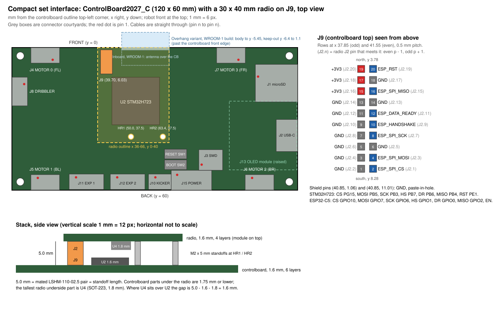

# Compact set: board-to-board interface and external connectors

This is the authoritative interface specification of the compact set:

- the board-to-board link between ControlBoard2027_C (CB) J9 and the radio J2, shared by both radio variants
  (RadioBoard2027_C_Inboard and RadioBoard2027_C_Overhang);
- the CB's external connectors and what each mating board must use.

The board and schematic files are the source of truth. Every pin and position here was read from them on
2026-11-07 (netlists exported with `kicad-cli sch export netlist`, positions from the board files with KiCad's
Python API).

**Coordinates.** All positions are in mm from the top-left corner of the board's own outline, x to the right
(east), y down (south). On the CB the robot front is at the top (y = 0). The CB board file has its outline corner at
(49.475, 49.475) and the radio board files at (97.0, 100.0); subtract those to compare with values read in KiCad.

## 1. Mechanical interface

| Item | Controlboard | Radio (both variants) |
|---|---|---|
| Outline | 120 x 60 mm, 6 layers, 1.6 mm | 30 x 40 mm, 4 layers, 1.6 mm |
| Radio position over the CB | radio outline covers CB x 36-66, y 0-40 | radio (0, 0) sits over CB (36, 0); same orientation, no rotation |
| Mezzanine | J9 at (39.70, 6.03), rotation 90, top side | J2 at (3.70, 6.03), rotation 90, bottom side |
| Part | Samtec LSHM-110-02.5-L-DV-A-S-K-TR (Razor Beam, 0.5 mm pitch, 2 x 10, shielded, hermaphroditic) | same part |
| Footprint | `ControlBoard2027:Samtec_LSHM-110-xx.x-x-DV-S_2x10-1SH_P0.50mm_Vertical_PIH` | `RadioBoard2027:Samtec_LSHM-110-xx.x-x-DV-S_2x10-1SH_P0.50mm_Vertical_PIH` |
| Standoff holes | HR1 (50.0, 37.5), HR2 (63.4, 37.5): 2.2 mm plated, pad on GND | H1 (14.0, 37.5), H2 (27.4, 37.5): 2.2 mm non-plated |
| Standoffs | two M2 x 5 mm (female-female or male-female), M2 screws | |
| Stack height | 5.0 mm board to board (mated LSHM-110-02.5 pair) | |

Both footprints are the stock KiCad LSHM footprint with paste added to the two shield through-holes (2.00 mm
stencil apertures, "paste-in-hole", Samtec recommended layout for LSHM-1XX-XX.X-X-DV-A-X-X-TR rev G).

**Mating rule.** The two connectors mate face to face, so the rows swap: CB J9 pin p meets radio J2 pin p - 1 for
even p and p + 1 for odd p. A pad-by-pad check of both radio board files against the CB board file puts all 20
contacts and both standoff holes at 0.000 mm offset (2026-11-07). The alignment pegs and shield tails of each
connector land on its own board, by design.

**Physical layout of J9.** The even (signal) row is at x 41.55, the odd row at x 37.85, 0.5 mm pitch from y 3.78
(pins 19 / 20, north) to y 8.28 (pins 1 / 2, south). Shield pins at (40.85, 1.06) and (40.85, 11.01). The connector
envelope (Samtec note 1) is x 37.2-42.2, y 0.96-11.11. On the radio the signal row is at x 5.55.

**Height keep-outs.**
- CB parts under the radio outline are 1.75 mm or lower: U2 (LQFP-144, 1.6 mm), the west end of U10 (SO-14,
  1.75 mm), X1 (0.8 mm) and 0402 / 0603 passives. Keep it so: nothing taller than 1.75 mm may be placed in
  CB x 36-66, y 0-40.
- The tallest part on the radio underside is U4 (MCP1826S LDO, SOT-223, 1.8 mm max). It sits partly (Inboard) or fully
  (Overhang) over U2, which leaves 5.0 - 1.6 - 1.8 = 1.6 mm. Nothing taller than 1.8 mm may be placed on the radio
  underside.
- The radio USB-C (J1) is on the radio's top side at its west edge (radio (3.70, 33.50) Inboard, (3.70, 28.20)
  Overhang). The plug enters from the west, above the CB at CB x 36. The CB has only a test pad (TP2) in that area.

**Antenna keep-outs.** Both variants are built primarily with the ESP32-C5-WROOM-1U (u.FL connector, external
antenna). The WROOM-1 (PCB antenna) is the fallback and fits the same footprint.

| Variant | WROOM-1 antenna area | Effect on the CB |
|---|---|---|
| Inboard | radio x 10.1-30.1, y 0-7.5, inside the radio outline | lies over CB x 46.1-66.1, y 0-7.5. The CB is not copper-free there (GND pours, radio MISO lane, LED SPI); see CB TODO. Matters only for the WROOM-1 build |
| Overhang | radio x 10.1-30.1, y -6.4 to 1.1 (keep-out rule area), past the radio's north edge | the WROOM-1 body sticks out 5.45 mm past the CB front edge (CB y = 0), its keep-out 6.4 mm. The robot mechanics must leave room for it in the WROOM-1 build |

With the WROOM-1U the u.FL cable leaves north over the module's antenna end.

## 2. J9 / J2 pin table

| J9 pin | CB net | J2 pin | Radio net | ESP32-C5 (module pad) | STM32H723 (LQFP pin) | Direction | Notes |
|---|---|---|---|---|---|---|---|
| 1 | GND | 2 | GND | | | | |
| 2 | ESP_SPI_CS | 1 | ESP_SPI_CS | GPIO10 (12), FSPICS0 | PG15 (132), GPIO | CB -> radio | R29 10k pull-up to +3V3 on the CB; radio ESD U6 ch 1->10 |
| 3 | GND | 4 | GND | | | | |
| 4 | ESP_SPI_MOSI | 3 | ESP_SPI_MOSI | GPIO7 (9), FSPID | PB5 (135), AF7 | CB -> radio | R66 30R in series at PB5; radio ESD U6 ch 2->9 |
| 5 | GND | 6 | GND | | | | |
| 6 | GND | 5 | GND | | | | |
| 7 | GND | 8 | GND | | | | |
| 8 | ESP_SPI_SCK | 7 | ESP_SPI_SCK | GPIO6 (8), FSPICLK | PB3 (133), AF6 | CB -> radio | R65 30R in series at PB3; radio ESD U6 ch 4->7 |
| 9 | GND | 10 | GND | | | | |
| 10 | ESP_HANDSHAKE | 9 | ESP_HANDSHAKE | GPIO1 (7) | PB7 (137), EXTI7 | radio -> CB | R31 100k pull-down on the CB; radio ESD U6 ch 5->6 |
| 11 | GND | 12 | GND | | | | |
| 12 | ESP_DATA_READY | 11 | ESP_DATA_READY | GPIO0 (6) | PB6 (136), EXTI6 | radio -> CB | R32 10k pull-down on the CB; radio ESD U5 ch 1->10 |
| 13 | GND | 14 | GND | | | | |
| 14 | GND | 13 | GND | | | | |
| 15 | +3V3 | 16 | +3V3_HOST | | | CB -> radio | supply |
| 16 | ESP_SPI_MISO | 15 | ESP_SPI_MISO | GPIO2 (4), FSPIQ | PB4 (134), AF6 | radio -> CB | R4 33R in series at the module (radio); radio ESD U5 ch 2->9 |
| 17 | +3V3 | 18 | +3V3_HOST | | | CB -> radio | supply |
| 18 | GND | 17 | GND | | | | |
| 19 | +3V3 | 20 | +3V3_HOST | | | CB -> radio | supply |
| 20 | ESP_RST | 19 | ESP_EN | EN / CHIP_PU (3), via R2 470R | PE1 (142), GPIO open drain | CB -> radio | EN pull-up R1 10k and C3 1 uF on the radio; radio ESD U5 ch 4->7 |
| SH | GND | SH | GND | | | | shield, paste-in-hole |

Notes:
- The signal row reads, north to south: RST, MISO, DATA_READY, HANDSHAKE, SCK, MOSI, CS. It is in the module-pad
  order on the radio, so no radio link line crosses another; the CB takes the order on L4 with the PB6 / PB7
  assignment (PB6 = DATA_READY, PB7 = HANDSHAKE).
- The CB has no ESD parts on the link: J9 is not exposed once the radio is plugged in, and the radio protects
  every link line at J2 (U5 / U6, TPD4E05U06, flow-through).
- The radio adds no pulls on the link lines. Once ESP-Hosted runs, it enables internal pull-ups on MOSI / SCK / CS
  and pull-downs on MISO / HANDSHAKE / DATA_READY. During reset and ROM boot only the CB pulls hold the lines.
- No line has opposing pulls. MISO has one pull, the radio-side pull-down; the CB sets no pull on PB4, and the
  ESP32-C5 slave tri-states MISO while CS is high. HANDSHAKE / DATA_READY are active high and idle low: R31 100k /
  R32 10k pull-downs on the CB, plus the radio's internal pull-downs once ESP-Hosted runs (same direction).
- Signal neighbours: SCK has GND on one side and HANDSHAKE on the other, GND across the row gap; MOSI sits between
  GND and CS; MISO has GND on both sides and +3V3 across the gap.

## 3. Power on the connector

- The CB supplies the muxed +3V3 rail (U9 output) on J9 pins 15 / 17 / 19 (radio +3V3_HOST, J2 pins 16 / 18 / 20).
  The radio is powered whenever the CB MCU is.
- Radio load: 313 mA peak at 2.4 GHz TX and 403 mA at 5 GHz TX (ESP32-C5-WROOM-1U datasheet v1.3, Tables 6-4 /
  6-5), about 0.13 A per pin. LSHM is rated 2 A per pin with one pin powered per row (Samtec LSHM specification
  §3); the margin is wide.
- CB side: C28 22 uF and C29 100 nF on +3V3 at J9 (bottom side, just west of J9). Radio side: D4 (Bourns
  CDSOD323-T03S, 3.3 V TVS) on +3V3_HOST right at J2, then C7 10 uF at the radio mux input.
- The radio has its own TPS2116 power mux (U3) between +3V3_HOST and its USB LDO. It blocks reverse current, so a
  radio running from its own USB cannot back-feed the CB rail. Switchover thresholds: see
  [FIRMWARE.md](FIRMWARE.md) §2.4.

## 4. SPI link

| Item | Controlboard (host) | Radio (ESP32-C5 slave) |
|---|---|---|
| Peripheral | SPI3 master, software NSS on PG15 | SPI2 (FSPI) slave on its IO_MUX pins, ESP-Hosted SPI full-duplex |
| Pins | PB3 SCK (AF6), PB4 MISO (AF6), PB5 MOSI (AF7), PG15 CS | GPIO6 CLK, GPIO2 MISO, GPIO7 MOSI, GPIO10 CS |
| Status lines | PB6 DATA_READY, PB7 HANDSHAKE (EXTI inputs), PE1 reset (open drain) | GPIO0 DATA_READY, GPIO1 HANDSHAKE, EN |
| Mode | mode 3, 8-bit, MSB first, hardware CRC off | mode 3 (ESP-Hosted default) |
| Termination | R65 / R66 30R at PB3 / PB5 (source series) | R4 33R at GPIO2 (MISO source series) |
| Routing | four lines on L4 (In3) between one via pair each, matched: SCK 14.861, MOSI / MISO / CS 14.860 mm | Inboard: 19.934 mm, Overhang: 14.079 mm, matched to 0.001 mm |

**Lengths.** CB lengths run from the MCU pad to the J9 pad (series-resistor span and via barrels included); radio
lengths from the J2 pad to the module pad (via and R4 span included). The mated LSHM pair adds about 3 mm. The whole
link is about 38 mm (Inboard) or 32 mm (Overhang), at about 6.7 ps/mm at most 0.26 ns one way. Each board is
matched on its own; neither board compensates for the other. HANDSHAKE, DATA_READY and RST are not matched (slow,
asynchronous): CB 8.9 / 10.1 / 14.7 mm, Inboard 18.5 / 18.7 mm, Overhang 12.9 / 12.6 mm.

**Clock rate.**
- The ESP32-C5 SPI slave is specified up to 40 MHz (ESP-IDF SPI slave driver). That is the ceiling.
- The CB side is limited by the SPI3 kernel clock. With SPI123SEL = PLL1Q = 48 MHz the fastest prescaler (/2) gives
  24 MHz. 40 MHz needs an 80 MHz SPI123 kernel clock (PLL2P or PLL3P) with /2.
- The ESP32-C5 slave's SCK-to-MISO valid delay is not published. At 40 MHz in mode 3 the master samples MISO
  12.5 ns after the slave shifts it.
- Plan: bring up at 3 MHz, run at 24 MHz, and try 40 MHz only after measuring the MISO valid delay at J9 on a
  scope. The copper (0.26 ns flight, a few ps skew) does not limit any of these rates.
- GPIO speed on the CB: SCK / MOSI OSPEEDR MEDIUM up to 24 MHz, HIGH at 40 MHz; CS (PG15) LOW or MEDIUM.

**HANDSHAKE / DATA_READY.** ESP-Hosted uses them as level / edge status lines from the slave: HANDSHAKE says the
slave is ready for a transaction, DATA_READY says it has data for the host. Both are active high and pulled low on
the CB, so an absent or resetting radio reads "not ready".

**Reset.** PE1 drives the radio EN low (open drain; never drive it high). ESP-Hosted holds EN low for 10 ms and then
waits 500 ms before it trusts HANDSHAKE / DATA_READY. PE1 is a 5 V-tolerant FT_h pin, so a radio on USB power with
the CB unpowered still comes out of reset (EN about 3.2 V); bench-check listed in the radio TODO.

## 5. Controlboard external connectors

All cables are straight through: pin n on this board goes to pin n on the mating connector. Signal names are the
CB's; where a line has a direction, the mating board uses the opposite one. All logic is 3.3 V.

| Ref | Function | CB part | Mating housing (JST) |
|---|---|---|---|
| J15 | POWER (powerboard) | JST PH S7B-PH-K-S, 7 pins, 2.0 mm, right angle | PHR-7 with SPH-002T-P0.5S contacts |
| J10 | KICKER (I2C) | JST GH SM04B-GHS-TB, 4 pins, 1.25 mm, right angle | GHR-04V-S with SSHL-002T-P0.2 contacts |
| J4-J8 | MOTOR 0-3, DRIBBLER (SPI) | JST GH SM06B-GHS-TB, 6 pins, right angle | GHR-06V-S |
| J11, J12 | EXP 1, EXP 2 (I2C + 5 V) | JST GH SM08B-GHS-TB, 8 pins, right angle | GHR-08V-S |
| J3 | SWD | Samtec FTSH-107-01-L-DV-K, 2 x 7, 1.27 mm, keyed (ST STDC14) | STLINK-V3 14-pin cable |
| J2 | USB | GCT USB4110-GF-A, USB 2.0 Type-C receptacle (device, Full Speed) | any USB-C cable |
| J1 | microSD | Hirose DM3AT-SF-PEJM5 push-push | microSD card |
| J13 | OLED | BOOMELE 2.54-1*4P 1 x 4 female socket | 0.96 in 128 x 64 SSD1306 I2C module |

### J15 POWER (powerboard)

| Pin | Net | Direction (CB view) | Notes |
|---|---|---|---|
| 1 | PWR_UART_TX | out | from PA0 (UART4_TX) through R33 1k |
| 2 | PWR_UART_RX | in | to PA1 (UART4_RX) through R34 1k |
| 3 | GND | | |
| 4 | +3V3_RAW | in (supply) | to D4 TVS, F6, U9 VIN1 |
| 5 | GND | | separates the two rails, so a one-pin crimp shift does not short them |
| 6 | +5V_RAW | in (supply) | to Q1 (reverse polarity), D3, F5, U8 VIN1 |
| 7 | GND | | |

**RX / TX convention.** RX and TX are named from the CB side: pin 1 is the CB's transmit output, pin 2 its receive
input. The powerboard receives on pin 1 and drives its UART TX on pin 2. UART4, 115200 8N1, 3.3 V logic.

The powerboard must supply 3.4 V +/-3 % (never above 3.6 V) on pin 4 and 5 V on pin 6. Each PH contact is rated
2 A and each rail has one contact, while F5 / F6 trip at 2.5 A: keep the steady load per rail well under 2 A (CB
DESIGN_NOTES, rail budget). The CB has no overvoltage protection beyond the TVS diodes, so the powerboard must
regulate. It must also be able to source more than 2.5 A per rail into a fault, or the fuses never trip.

### J10 KICKER

| Pin | 1 | 2 | 3 | 4 | MP |
|---|---|---|---|---|---|
| Net | KICKER_I2C_SDA | GND | KICKER_I2C_SCL | GND | GND |

I2C2 master on PB11 (SDA) / PB10 (SCL), 400 kHz, pull-ups R19 / R18 2.2k on the CB, ESD U17 at the connector. No
power pin: the kicker is powered by the powerboard. The kicker must be an I2C target with no pull-ups to a rail
above 3.3 V.

### J4-J8 MOTOR 0-3 and DRIBBLER

| Pin | 1 | 2 | 3 | 4 | 5 | 6 | MP |
|---|---|---|---|---|---|---|---|
| Signal | MOSI (out) | GND | MISO (in) | SCK (out) | GND | CS (out, active low) | GND |

| Connector | Position | Bus | STM32 pins (SCK / MISO / MOSI / CS) |
|---|---|---|---|
| J4 MOTOR 0 | front left, north edge | SPI1 | PA5 / PA6 / PA7 / PC5 |
| J5 MOTOR 1 | back left, south edge | SPI1 | PA5 / PA6 / PA7 / PB0 |
| J6 MOTOR 2 | back right, south edge | SPI2 | PB13 / PB14 / PB15 / PB12 |
| J7 MOTOR 3 | front right, north edge | SPI2 | PB13 / PB14 / PB15 / PD8 |
| J8 DRIBBLER | west edge | SPI4 | PE2 / PE5 / PE6 / PE3 |

No supply pin: the motor modules take their power elsewhere. Each connector has its own TPD4E05U06 ESD array
(U4 J4, U5 J5, U12 J6, U13 J7, U14 J8). CS pull-ups R24-R28 10k, SCK pull-downs R30 / R69 / R72 100k. The motor
module must use this pin order and release MISO (high impedance) while its CS is high. The motor wheel numbering
(0 FL, 1 BL, 2 BR, 3 FR, counter-clockwise from front left) is an assumption; firmware maps it.

### J11 / J12 EXP 1 / EXP 2

| Pin | 1 | 2 | 3 | 4 | 5 | 6 | 7 | 8 | MP |
|---|---|---|---|---|---|---|---|---|---|
| J11 | GND | GND | +5V_EXT1 | +5V_EXT1 | GND | EXPANSION_SCL | GND | EXPANSION_SDA | GND |
| J12 | GND | GND | +5V_EXT2 | +5V_EXT2 | GND | EXPANSION_SCL | GND | EXPANSION_SDA | GND |

Both ports share I2C4 (PF14 SCL, PF15 SDA, pull-ups R10 / R8 2.2k, ESD U6 at J11 and U16 at J12). +5V_EXT1 / 2 come
from +5V through their own PTC (F3 / F4, hold 0.75 A at 23 °C, 0.55 A at 50 °C). Budget 0.55 A for both ports
together. Expansion boards must not add their own I2C pull-ups.

### J3 SWD (STDC14)

| Pin | Net | Pin | Net |
|---|---|---|---|
| 1 | NC | 2 | NC |
| 3 | +3V3 (VCC sense) | 4 | SWDIO (PA13) |
| 5 | GND | 6 | SWCLK (PA14) |
| 7 | GND | 8 | NC (SWO not available: PB3 is the radio SCK) |
| 9 | NC | 10 | NC |
| 11 | GND (GNDDetect) | 12 | NRST |
| 13 | NC | 14 | NC |

Use a keyed STDC14 cable (STLINK-V3) and match the pin-1 marker. The schematic uses KiCad's official
`Connector:Conn_ST_STDC14` symbol, so the pin names match ST's STDC14 pinout.

### J13 OLED module

| Pin | 1 | 2 | 3 | 4 |
|---|---|---|---|---|
| Net | GND | +3V3 | OLED_I2C_SCL | OLED_I2C_SDA |

A generic 0.96 in 128 x 64 SSD1306 I2C module plugs in raised over the service edge (I2C1 PB8 / PB9, address 0x3C,
pull-ups R14 / R17 2.2k on the CB; the module's own pull-ups add in parallel). The footprint has four 2.6 mm holes
for M2 nylon standoffs. Some modules swap VCC and GND: check the module before fitting.

### J2 USB-C and J1 microSD

- J2: USB 2.0 Full Speed device (STM32 OTG_HS in FS mode, PA11 / PA12), CC1 / CC2 5.1k Rd (sink), all four data
  contacts through U3 (TPD4E05U06) flow-through, VBUS TVS D1 and PTC F1. Also powers the board on the bench.
- J1: microSD on SDMMC2, 4-bit, no card-detect pin.

## 6. Changing the interface

The interface is shared by three projects. Any change to J9 / J2 position, rotation, pinout or the standoff holes
must be made in ControlBoard2027_C, RadioBoard2027_C_Inboard and RadioBoard2027_C_Overhang together, then:

1. re-run the pad-by-pad mating check of both radio board files against the CB board file;
2. re-measure the link lengths on all three boards and re-match each board on its own;
3. update this file, [FIRMWARE.md](FIRMWARE.md) and the three boards' DESIGN_NOTES.

Related documents: [../README.md](../README.md), [FIRMWARE.md](FIRMWARE.md),
[PROTOTYPE_TO_COMPACT.md](PROTOTYPE_TO_COMPACT.md),
[ControlBoard2027_C DESIGN_NOTES](../ControlBoard2027_C/DESIGN_NOTES.md),
[Inboard DESIGN_NOTES](../RadioBoard2027_C_Inboard/DESIGN_NOTES.md),
[Overhang DESIGN_NOTES](../RadioBoard2027_C_Overhang/DESIGN_NOTES.md).
