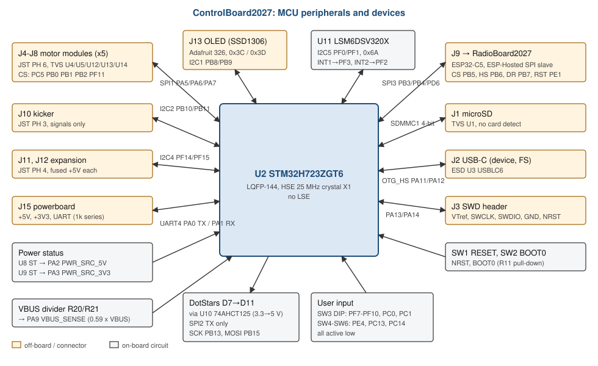
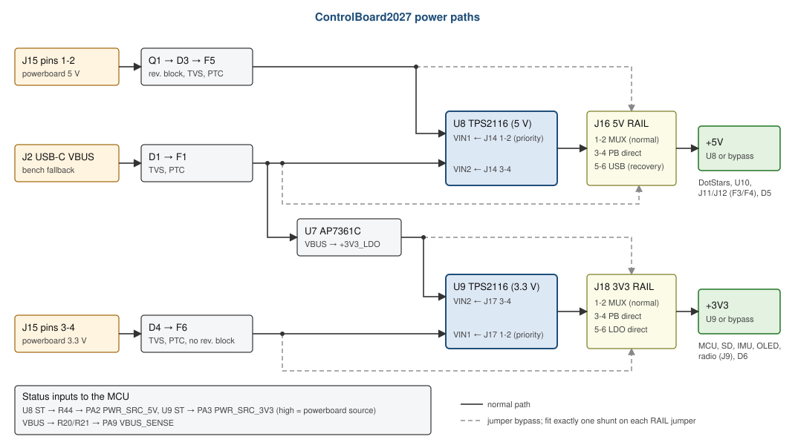

# ControlBoard2027 Firmware Specification

What the STM32 firmware for the 2027 control board must do, and what the hardware gives it to do
it with. Written for the firmware team.

| | |
|---|---|
| Board | ControlBoard2027, as ordered 2026-10-11 (PCB commit `79d0015`, schematic `61fa0d1`) |
| MCU | ST STM32H723ZGT6, LQFP-144 ([datasheet DS13313](https://www.st.com/resource/en/datasheet/stm32h723zg.pdf), [reference manual RM0468](https://www.st.com/resource/en/reference_manual/rm0468-stm32h723733-stm32h725735-and-stm32h730-value-line-advanced-armbased-32bit-mcus-stmicroelectronics.pdf)) |
| Companion board | RadioBoard2027 (ESP32-C5 Wi-Fi), see [RadioBoard2027_SPEC.md](RadioBoard2027_SPEC.md) |
| Date | 2026-10-13 |

**Source of truth.** Every pin and part here was taken from the schematic (netlist exported on
2026-10-13). If this document and the schematic disagree, the schematic wins. The CubeMX report
`ControlBoard_TestingV0.3.pdf` in this folder is **out of date**: §3.2 lists every difference.
The design reasoning lives in `../ControlBoard2027/DESIGN_NOTES.md`; the hardware audit in
[AUDIT_2026-10-13.md](AUDIT_2026-10-13.md).

**Contents**

1. [System overview](#1-system-overview)
2. [Clocks](#2-clocks)
3. [Pin map](#3-pin-map)
4. [Power and power-source handling](#4-power-and-power-source-handling)
5. [Interfaces](#5-interfaces)
6. [Boot, flashing and debug](#6-boot-flashing-and-debug)
7. [Bring-up checklist](#7-bring-up-checklist)
8. [Hardware limitations firmware must handle](#8-hardware-limitations-firmware-must-handle)
9. [Hardware reference](#9-hardware-reference)

---

## 1. System overview

| Function | MCU peripheral | Pins | Device | Firmware owns |
|---|---|---|---|---|
| Motor modules (4 wheels + dribbler) | SPI1 master | PA5 SCK, PA6 MISO, PA7 MOSI; CS PC5, PB0, PB1, PB2, PF11 | Motor modules on J4-J8 | Motor protocol, CS sequencing |
| Radio | SPI3 master | PB3 SCK, PB4 MISO, PD6 MOSI; CS PB5; HANDSHAKE PB6; DATA_READY PB7; reset PE1 | ESP32-C5 running ESP-Hosted (slave) | ESP-Hosted host driver |
| Status LEDs | SPI2 master, TX only | PB13 SCK, PB15 MOSI | 5 x APA102-type RGB LEDs (BB-2020BGR-TRB) via 74AHCT125 | LED frames, current cap |
| SD card | SDMMC1, 4-bit | PC8-PC11 D0-D3, PC12 CK, PD2 CMD | microSD socket J1 | SD/FatFs, card detection by init |
| OLED | I2C1 | PB8 SCL, PB9 SDA | SSD1306 128x64 (Adafruit 326), 0x3C or 0x3D | Display driver |
| Kicker | I2C2 | PB10 SCL, PB11 SDA | Kicker board on J10 | Kicker protocol |
| Expansion | I2C4 | PF14 SCL, PF15 SDA | Up to two boards on J11/J12 (shared bus) | Device drivers |
| IMU | I2C5 | PF0 SDA, PF1 SCL; INT1 PF3, INT2 PF2 | ST LSM6DSV320X at 0x6A | IMU driver |
| Powerboard | UART4 | PA0 TX, PA1 RX | Powerboard on J15 | Powerboard protocol |
| USB | USB_OTG_HS with internal FS PHY, device | PA11 DM, PA12 DP; VBUS sense PA9 (GPIO) | USB-C J2 | USB device class, connect/disconnect |
| Robot ID | GPIO in | PF7-PF10, PC0, PC1 | 6-way DIP SW3 | Read ID |
| User buttons | GPIO in / EXTI | PE4, PC13, PC14 | SW4-SW6 | Debounce, actions |
| Power source | GPIO in | PA2, PA3 | Power muxes U8/U9 status | Re-init on change |
| Debug | SWD | PA13 SWDIO, PA14 SWCLK, NRST | Header J3 | - |

The board has **no** LSE crystal, **no** SD card-detect, **no** SD power switch, **no** SWO trace
pin, and no spare GPIO brought out to a header.

---

## 2. Clocks

| Source | Value | Notes |
|---|---|---|
| HSE | **25.000 MHz crystal** (X1, Abracon ABM8, ±10 ppm, CL 10 pF) on PH0/PH1 | Crystal mode, not bypass. `HSE_VALUE = 25000000` |
| LSE | None | Keep LSE and the RTC clock source off; PC14/PC15 are GPIO |
| HSI48 | Internal | Usable for USB with CRS, but needs USB SOF to trim; HSE-derived 48 MHz is preferred |

Hardware requirements on the clock tree:
- USB full speed needs 48 MHz ±0.25%: take it from a PLL fed by HSE.
- SDMMC1 default speed is limited to 25 MHz card clock (§5.4).
- The LED chain must stay at or below 10 MHz SPI clock (§5.3).

Example plan that meets all of them (check in CubeMX; it computes flash latency and limits):

| Setting | Value | Result |
|---|---|---|
| PLL source | HSE 25 MHz | |
| PLL1 DIVM | 5 | 5 MHz PLL input |
| PLL1 DIVN | 96 | 480 MHz VCO |
| PLL1 DIVP | 2 | SYSCLK 240 MHz |
| PLL1 DIVQ | 10 | 48.000 MHz for USB, SDMMC1 and SPI1/2/3 kernel clocks |
| Voltage scale | VOS1 with HPRE /2, or VOS0 | At VOS1 the AHB limit is 200 MHz |
| Supply | `PWR_LDO_SUPPLY` | The H723 has no SMPS; the board powers it through the internal LDO |

With 48 MHz SPI kernel clocks the available SPI rates are 24, 12, 6, 3 ... Mbit/s. Rates such as
15.625 Mbit/s from the planning document need a different kernel clock (PLL2 or PLL3).

---

## 3. Pin map

### 3.1 All connected pins
"Board pulls" are the external resistors on the board; leave the internal pull-ups and pull-downs
off unless noted.

| Pin | Port | Net | Configure as | Board pulls / series | Notes |
|---|---|---|---|---|---|
| 3 | PE4 | USER_EXTI0 | Input, EXTI4, falling edge | 10k up + 10k series, 100 nF | Button SW4 (BTN0), pressed = low |
| 7 | PC13 | USER_EXTI1 | Input, EXTI13, falling edge | same | Button SW5 (BTN1). Keep RTC tamper/wake-up off |
| 8 | PC14 | USER_EXTI2 | Input, EXTI14, falling edge | same | Button SW6 (BTN2). LSE must stay off |
| 10 | PF0 | IMU_I2C_SDA | I2C5_SDA, open drain | 2.2k up | |
| 11 | PF1 | IMU_I2C_SCL | I2C5_SCL, open drain | 2.2k up | |
| 12 | PF2 | GYRO_EXTI | Input, EXTI2, rising edge | none | IMU INT2 (push-pull) |
| 13 | PF3 | ACCEL_EXTI | Input, EXTI3, rising edge | none | IMU INT1 (push-pull) |
| 19-22 | PF7-PF10 | DIP0-DIP3 | Input | 100k up | Switch ON = low |
| 23, 24 | PH0, PH1 | - | RCC_OSC_IN / OUT | | 25 MHz crystal |
| 26, 27 | PC0, PC1 | DIP4, DIP5 | Input | 100k up | Switch ON = low |
| 34 | PA0 | PWR_UART_TX | UART4_TX | 1k series | To powerboard |
| 35 | PA1 | PWR_UART_RX | UART4_RX | 1k series | From powerboard |
| 36 | PA2 | PWR_SRC_5V | Input (poll) | 10k up via 10k series | High = 5 V from powerboard. EXTI2 is used by PF2 |
| 37 | PA3 | PWR_SRC_3V3 | Input (poll) | 10k up | High = 3.3 V from powerboard. EXTI3 is used by PF3 |
| 41 | PA5 | MOTOR_SPI_SCK | SPI1_SCK | 30 Ω series, 100k down (bus side) | |
| 42 | PA6 | MOTOR_SPI_MISO | SPI1_MISO | none | Shared by all five modules |
| 43 | PA7 | MOTOR_SPI_MOSI | SPI1_MOSI | 30 Ω series | |
| 45 | PC5 | MOTOR0_SPI_CS | Output push-pull, init **high** | 10k up | J4 "MOTOR 0" |
| 46 | PB0 | MOTOR1_SPI_CS | Output push-pull, init **high** | 10k up | J5 "MOTOR 1" |
| 47 | PB1 | MOTOR2_SPI_CS | Output push-pull, init **high** | 10k up | J6 "MOTOR 2" |
| 48 | PB2 | MOTOR3_SPI_CS | Output push-pull, init **high** | 10k up | J7 "MOTOR 3" |
| 49 | PF11 | DRIBBLER_SPI_CS | Output push-pull, init **high** | 10k up | J8 "DRIBBLER" |
| 54 | PF14 | EXPANSION_SCL | I2C4_SCL, open drain | 2.2k up | J11 + J12 |
| 55 | PF15 | EXPANSION_SDA | I2C4_SDA, open drain | 2.2k up | J11 + J12 |
| 69 | PB10 | KICKER_I2C_SCL | I2C2_SCL, open drain | 2.2k up | J10 |
| 70 | PB11 | KICKER_I2C_SDA | I2C2_SDA, open drain | 2.2k up | J10 |
| 74 | PB13 | LED_SPI_SCK | SPI2_SCK | 100k down | To U10 1A |
| 76 | PB15 | LED_SPI_MOSI | SPI2_MOSI | 100k down | To U10 4A |
| 98 | PC8 | SDMMC_D0 | SDMMC1_D0 | 47k up | |
| 99 | PC9 | SDMMC_D1 | SDMMC1_D1 | 47k up | |
| 101 | PA9 | VBUS_SENSE | Input | 47k / 68k divider from VBUS | High (≈ 2.96 V) when USB VBUS is present |
| 103 | PA11 | USB_DM | USB_OTG_HS_DM (FS PHY) | | |
| 104 | PA12 | USB_DP | USB_OTG_HS_DP (FS PHY) | | |
| 105 | PA13 | SWDIO | SWD | | Do not reconfigure |
| 109 | PA14 | SWCLK | SWD | | Do not reconfigure |
| 110 | PA15 | - | Leave as reset state / analog | 10k up | Unused; pull-up only for the ROM bootloader |
| 111 | PC10 | SDMMC_D2 | SDMMC1_D2 | 47k up | |
| 112 | PC11 | SDMMC_D3 | SDMMC1_D3 | 47k up | |
| 113 | PC12 | SDMMC_CK | SDMMC1_CK | 30 Ω series | |
| 116 | PD2 | SDMMC_CMD | SDMMC1_CMD | 47k up | |
| 122 | PD6 | ESP_SPI_MOSI | SPI3_MOSI | 30 Ω series | |
| 133 | PB3 | ESP_SPI_SCK | SPI3_SCK | 30 Ω series | SWO is lost |
| 134 | PB4 | ESP_SPI_MISO | SPI3_MISO | none | Enable the internal pull-up so MISO idles high while the radio is absent |
| 135 | PB5 | ESP_SPI_CS | Output push-pull, init **high** | 10k up | |
| 136 | PB6 | ESP_HANDSHAKE | Input, EXTI6, rising edge | 100k down | |
| 137 | PB7 | ESP_DATA_READY | Input, EXTI7, rising edge | 10k down | |
| 138 | BOOT0 | BOOT0 | - | 10k down, button to 3V3 | |
| 139 | PB8 | OLED_I2C_SCL | I2C1_SCL, open drain | 2.2k up (+10k on the module) | |
| 140 | PB9 | OLED_I2C_SDA | I2C1_SDA, open drain | 2.2k up (+10k on the module) | |
| 142 | PE1 | ESP_RST | Output **open drain**, init released (high-Z) | pull-up on the radio board | Low = radio in reset. Never drive high |

**Unconnected GPIO** (set to analog for lowest power; none reach a header or pad): PA4, PA8,
PA10, PB12, PB14, PC2_C, PC3_C, PC4, PC6, PC7, PC15, PD0, PD1, PD3-PD5, PD7-PD15, PE0, PE2, PE3,
PE5-PE15, PF4-PF6, PF12, PF13, PG0-PG15.

EXTI lines in use: 2 (PF2), 3 (PF3), 4 (PE4), 6 (PB6), 7 (PB7), 13 (PC13), 14 (PC14). PA2 and PA3
cannot use EXTI2/EXTI3, so poll them.

### 3.2 Differences from CubeMX V0.3
Change the `.ioc` to match the board:

| Item | V0.3 | Board |
|---|---|---|
| ESP_SPI_CS | PG15 | **PB5** |
| ESP_HANDSHAKE | PB5 | **PB6** |
| ESP_DATA_READY | PB6 | **PB7** |
| ESP_RST | PB7, push-pull | **PE1, open drain** |
| SPI2_SCK (LEDs) | PA9 | **PB13** |
| PA9 | SPI2_SCK | **VBUS_SENSE, GPIO input** |
| Detect_SDIO (FatFs card detect) | PG7 | **none** (PG7 unconnected) |
| PWR_SRC_5V / PWR_SRC_3V3 | - | **PA2 / PA3**, inputs |
| User buttons | Rising-edge EXTI | **Falling edge** (active low) |
| HSE | must be checked | **25 MHz crystal** |
| SPI1/SPI3 data size | 4 bits | 8 bits (ESP-Hosted); motor size per motor protocol |
| SPI3 hardware CRC | On | **Off** (ESP-Hosted has its own checksum) |
| SPI Master Keep IO State | Disabled | **Enabled** on SPI1/2/3, so SCK does not float between transfers |
| I2C timing values | Computed for the old clock | Recompute after the clock change |
| Free pins | Not analog | Set "all free pins as analog" |

Unchanged and correct in V0.3: UART4 PA0/PA1, SPI1 PA5-PA7 and the five motor CS pins, SPI3
PB3/PB4/PD6, SDMMC1, I2C1/2/4/5 pins, IMU interrupts PF2/PF3, DIP pins, button pins, USB PA11/PA12,
SWD.

---

## 4. Power and power-source handling

### 4.1 Sources and what firmware can see

| Source | Rails | Signal to firmware |
|---|---|---|
| Powerboard (J15): 5 V and 3.3 V | +5V via mux U8, +3V3 via mux U9 | PA2 `PWR_SRC_5V` high, PA3 `PWR_SRC_3V3` high |
| USB-C VBUS (bench) | +5V via U8, +3V3 via LDO U7 and mux U9 | PA9 `VBUS_SENSE` high; PA2/PA3 low if the powerboard is absent |

Each mux prefers the powerboard and falls back to USB automatically. The status pins only show
the mux state: if someone moves a RAIL jumper to a bypass position (J16/J18 3-4 or 5-6), the pins
no longer describe the real source.

### 4.2 Operating modes

| Mode | PA2 | PA3 | PA9 | What firmware should allow |
|---|---|---|---|---|
| Robot: powerboard only | 1 | 1 | 0 | Everything. LED chain ≤ 250 mA total |
| Bench: USB only | 0 | 0 | 1 | Debug and flashing. LED chain ≤ 100 mA total. No radio transmit at high duty and no expansion loads (USB fuse holds only 0.55 A when warm) |
| Bench: both | 1 | 1 | 1 | As robot. Expect rail dips when the powerboard is plugged or unplugged (§8) |
| Mixed (one powerboard rail missing) | 0/1 | 1/0 | x | Fault: report it |

### 4.3 Required handling
- Set a **BOR level** in the option bytes, so a rail sag resets the MCU cleanly.
- Poll PA2/PA3 (for example every 10 ms). On any change: pulse the radio reset and restart
  ESP-Hosted, re-initialise the SD card, IMU and OLED, and resend the LED frame. The switchover
  can dip +3V3 to about 2.6 V (§8).
- Drive UART4 TX only while the powerboard is present (PA3 high).
- USB: connect the USB device (enable the D+ pull-up) only while PA9 is high; disconnect when it
  goes low. Disable the OTG hardware VBUS sensing: the board divider only reaches ≈ 2.96 V.

### 4.4 Current budget (what firmware controls)

| Load | Rail | Limit |
|---|---|---|
| DotStar chain | +5V | 500 mA at full white. Cap at 250 mA on powerboard, 100 mA on USB |
| Expansion ports J11 + J12 | +5V | 0.55 A combined (each port has its own fuse) |
| Radio | +3V3 | Up to ≈ 0.4 A peaks during Wi-Fi transmit |
| MCU, SD, IMU, OLED | +3V3 | ≈ 0.35 A (estimate) |
| Powerboard input fuses | each rail | 0.95 A hold at 50 °C |

---

## 5. Interfaces

### 5.1 Motor modules (SPI1, J4-J8)
- Shared SCK/MOSI/MISO, one active-low CS per module. CS pull-ups hold every module deselected
  through reset; initialise all five CS outputs high before enabling SPI1.
- MISO is shared by five modules: each module must release (high-Z) MISO while its CS is high.
  Never assert two CS lines at once.
- SPI mode, frame size and rate are set by the motor-module protocol (V0.3 used mode 0). SCK and
  MOSI have 30 Ω damping resistors that are not yet qualified on the cables: start at 6 Mbit/s and
  check SCK at TP4 with all five cables fitted before going faster.
- Connector order: J4 MOTOR 0 (CS PC5), J5 MOTOR 1 (PB0), J6 MOTOR 2 (PB1), J7 MOTOR 3 (PB2),
  J8 DRIBBLER (PF11).
- **The existing motor-module board uses an 8-pin connector with a different pinout**; adapter
  cables or a new motor-module revision are needed before testing (§8).

### 5.2 Radio (SPI3, J9 → RadioBoard2027)

| Item | Value |
|---|---|
| Role | STM32 = SPI master and ESP-Hosted host; ESP32-C5 = slave/co-processor |
| SPI mode | **Mode 3** (CPOL = 1, CPHA = 1), the ESP-Hosted default; must match the radio build |
| Frame | 8-bit, MSB first; hardware CRC off (ESP-Hosted adds a 16-bit checksum) |
| Rate | Bring up at 3-6 Mbit/s, then raise (48 MHz kernel: 12 or 24 Mbit/s). The link is laid out for 50 Ω and length-matched across both boards |
| CS | PB5, software-controlled, active low |
| HANDSHAKE | PB6, input, active high, rising-edge interrupt. Board pull-down holds it low while the radio is absent or in reset |
| DATA_READY | PB7, input, active high, rising-edge interrupt. Board 10k pull-down holds it low |
| Reset | PE1 open drain → radio EN. Pull low ≥ 10 ms to reset, then release and wait ≥ 500 ms before trusting HANDSHAKE/DATA_READY (radio EN has a 10 ms RC) |
| Radio power | Always on with +3V3; no power control from the MCU |

The STM32 cannot put the ESP32 into its ROM download mode (it only controls EN, not the boot
strap). Radio firmware is updated over the radio's own USB-C or by an OTA mechanism in the
ESP-Hosted firmware.

### 5.3 DotStar LEDs (SPI2 TX, U10 → D7-D11)
- Data is latched on the rising edge of the LED clock: **SPI mode 0**, MSB first, 8-bit.
- **Clock ≤ 10 MHz** (datasheet: recommended 11 MHz, absolute 12 MHz, operating < 10 MHz).
  With a 48 MHz kernel clock use prescaler 8 (6 Mbit/s) or 16 (3 Mbit/s).
- Frame (APA102 format): 32-bit start frame of zeros; then per LED 32 bits: `111` + 5-bit global
  brightness, then Blue, Green, Red bytes; then an end frame of at least 32 bits (enough clock
  edges to push data through the 5-LED chain).
- Chain order: first LED in the frame = **D7** (west end of the row), then D8, D9, D10, D11 (east
  end). The five LEDs sit in one straight row at 4 mm pitch.
- The power-on state is undefined: send an all-off frame at start-up.
- Up to ≈ 100 mA per LED at full white; enforce the caps in §4.4.
- LEDs need 4.5-5.5 V: colours are only reliable on powerboard power.
- Debug: TP18/TP19 show data/clock entering D7, TP20/TP21 the data/clock leaving D11.

### 5.4 SD card (SDMMC1, 4-bit, J1)
- 3.3 V signalling only (no 1.8 V switch): default speed and high speed only, no UHS modes.
- Card supply is permanently on (no power switch): a hung card can only be recovered with CMD0 or
  a board power cycle.
- **No card-detect pin**: report the card as present and treat an initialisation failure as "no
  card". Remove the PG7 detect from the FatFs/BSP configuration.
- Clock: initialise at ≤ 400 kHz, then run at 24 MHz (48 MHz kernel, CLKDIV = 1). The board was
  laid out for this speed; scope TP1 before trying faster.
- External pull-ups on CMD and D0-D3; CLK has a 30 Ω series resistor.
- SDMMC1's internal DMA cannot reach DTCM: put SD buffers in AXI SRAM (check RM0468) and handle
  D-cache coherency.

### 5.5 I2C buses
All four buses have 2.2k pull-ups to 3.3 V on the board; keep the internal pull-ups off. Run at
400 kHz (Fast mode). Let CubeMX compute the timing register with measured rise times.

| Bus | Pins | Devices | Address | Notes |
|---|---|---|---|---|
| I2C1 | PB8 SCL, PB9 SDA | SSD1306 OLED 128x64 (Adafruit 326) | 0x3C, try 0x3D too | Module adds 10k pull-ups. The image is rotated 90° relative to the header: set the display rotation (u8g2 `U8G2_R1` or `U8G2_R3`) |
| I2C2 | PB10 SCL, PB11 SDA | Kicker board (J10) | Set by kicker | Protocol not defined yet |
| I2C4 | PF14 SCL, PF15 SDA | Expansion boards (J11, J12 on one bus) | Per device | Boards must not add 5 V pull-ups |
| I2C5 | PF1 SCL, PF0 SDA | LSM6DSV320X IMU | **0x6A** | See below |

Before each init, run I2C bus recovery (up to 9 SCL pulses, then STOP): the IMU and modules have
no reset line.

**IMU (LSM6DSV320X)**
- `WHO_AM_I` (0x0F) = **0x73**. Use the LSM6DSV320X driver (the design started on the
  pin-compatible LSM6DSK320X, which has a different ID and register set).
- Low-g accelerometer up to ±16 g, high-g accelerometer up to ±320 g, gyroscope up to ±4000 dps.
- INT1 → PF3 (`ACCEL_EXTI`), INT2 → PF2 (`GYRO_EXTI`). Push-pull, active high by default; any event
  can be routed to either pin. The net names are historical.
- No reset pin: use the SW_RESET bit after a brown-out or power-source change.

### 5.6 Powerboard UART (UART4, J15)
- PA0 TX → J15 pin 7, PA1 RX ← J15 pin 8, 3.3 V logic, 1k series resistors on both lines.
- 115200 8N1 (from the planning document); the protocol is defined with the powerboard team.
- Drive TX only while the powerboard is present (PA3 high), so the 1k does not feed an unpowered
  powerboard.

### 5.7 USB (USB_OTG_HS, internal full-speed PHY)
- Device only, full speed (12 Mbit/s), PA11/PA12, self-powered.
- VBUS is not on a VBUS pin: read PA9 as a GPIO and call connect/disconnect on its edges; disable
  hardware VBUS sensing.
- 48 MHz from the HSE PLL (§2).
- CC lines have 5.1k pull-downs: the host offers default USB power only. Do not draw more than
  500 mA from USB (§4.2).

### 5.8 Robot ID DIP (SW3)
| Bit | 0 | 1 | 2 | 3 | 4 | 5 |
|---|---|---|---|---|---|---|
| Pin | PF7 | PF8 | PF9 | PF10 | PC0 | PC1 |

Switch ON (closed) reads **0**. Suggested: `id = ~pins & 0x3F`, so switch ON = bit set. Read at
boot (100k pull-ups: wait a few µs after configuring the pins). The switches ship in the ON
position.

### 5.9 User buttons (SW4-SW6)
BTN0 PE4, BTN1 PC13, BTN2 PC14. Pressed = low. The board RC (1 ms press / 2 ms release) is shorter
than the switch bounce, so debounce in software (ignore edges for ≈ 10 ms).

### 5.10 Indicators not under firmware control
D5 (red, +5V present) and D6 (red, +3V3 present) are wired to the rails.

---

## 6. Boot, flashing and debug

| Method | How |
|---|---|
| USB DFU (ROM bootloader) | Hold **BOOT0** (SW2), press and release **RST** (SW1), release BOOT0. The STM32 enumerates as DFU over USB-C. Use STM32CubeProgrammer or `dfu-util` |
| SWD | J3 1x5 header: pin 1 VTref (+3V3), 2 SWCLK, 3 SWDIO, 4 GND, 5 NRST. Pins 1-4 match the motor-module SWD order. **Not keyed**: check pin 1 before plugging in. Start at ≤ 1 MHz |
| Reset | SW1 RST, or NRST on J3 pin 5 |
| Trace | No SWO (PB3 is SPI3 SCK). Use the USB CDC port or UART4 test points for logging |

After DFU with an older ROM bootloader, power-cycle the board before running the application.

Useful test points for firmware debug (all labelled on the silkscreen):

| TP | Signal | TP | Signal |
|---|---|---|---|
| TP1 | SD clock at the card | TP10 / TP11 | UART4 RX / TX |
| TP4 / TP5 / TP6 | Motor SCK / MOSI / MISO | TP3 | VBUS |
| TP7 | Kicker SCL | TP16 / TP17 | +5V / +3V3 |
| TP8 | Expansion SCL | TP18 / TP19 | LED data / clock into D7 |
| TP9, TP12 | GND | TP20 / TP21 | LED data / clock out of D11 |

---

## 7. Bring-up checklist

1. Before the first power-up: check the J15 cable (5 V and 3.3 V are on adjacent pins and the
   3.3 V input has no protection) and the six power jumper shunts (§9.3).
2. Power from USB only. D6 lights. Connect SWD, read the chip ID.
3. Clock: start HSE, check 25 MHz (MCO or timer measurement). Enable the PLLs.
4. USB DFU entry with BOOT0 + RST works; USB CDC enumerates; unplug detection via PA9 works.
5. DIP and buttons read correctly.
6. LEDs: send an all-off frame, then one LED at low brightness. If nothing lights, check TP18-TP21
   (footprint orientation is unconfirmed, §8).
7. I2C: scan all four buses. IMU answers at 0x6A with WHO_AM_I 0x73; OLED at 0x3C or 0x3D.
8. SD: initialise at 400 kHz, then 24 MHz; check TP1.
9. Powerboard: check PA2/PA3 go high, UART4 link.
10. Radio: fit RadioBoard2027, release PE1, wait 500 ms, bring ESP-Hosted up at 3-6 Mbit/s.
11. Motor bus: with adapter cables, one module at a time, then all five; scope TP4-TP6.
12. Power-source changes: plug/unplug the powerboard with USB attached; check that firmware
    re-initialises everything (§4.3).

---

## 8. Hardware limitations firmware must handle

From the 2026-10-13 audit ([AUDIT_2026-10-13.md](AUDIT_2026-10-13.md)). These are fixed in the
hardware as ordered.

| Limitation | Impact | Firmware response |
|---|---|---|
| Power-mux switchover thresholds are low (3.3 V mux at ≈ 2.34 V falling / 2.57 V rising; 5 V at ≈ 3.55 / 3.88 V). Plugging the powerboard in while on USB dips +3V3 to ≈ 2.6 V | Radio browns out; USB and SD can glitch (bench only) | BOR level; re-initialise on every PA2/PA3 change (§4.3) |
| Motor connectors J4-J8 do not match the existing 8-pin motor module | Motor bus cannot be tested without adapters | Wait for adapter cables / new motor module |
| DotStar footprint orientation unconfirmed | Chain may not light (no damage) | Check on the first board (§7 step 6) |
| Button RC shorter than the switch bounce | Multiple interrupts per press | Software debounce |
| No SD card detect or power switch | Card presence unknown; hung card needs CMD0 or power cycle | Detect by init; CMD0 recovery |
| USB-only power is limited (fuse 0.55 A warm) | Brown-out or fuse trip with radio and LEDs on | Limit LEDs and radio on USB (§4.2) |
| Radio held only by its connector | Link may drop on impact | Detect loss of HANDSHAKE/DATA_READY activity and reset the radio |
| No SWO | No trace output | Log over USB CDC or UART |
| Free GPIO are not brought out | No spare I/O | - |

---

## 9. Hardware reference

### 9.1 Connectors (pinouts from this board's side)

**J15 Powerboard** (JST XH 8-pin): 1-2 +5V in, 3-4 +3V3 in, 5-6 GND, 7 UART TX (MCU out), 8 UART RX
(MCU in).

**J4-J8 Motor** (JST PH 6-pin): 1 GND, 2 SCK, 3 GND, 4 MOSI, 5 MISO, 6 CS. No power.

**J10 Kicker** (JST PH 3-pin): 1 GND, 2 SCL, 3 SDA. No power.

**J11, J12 Expansion** (JST PH 4-pin): 1 +5V (separately fused, 0.55 A warm), 2 GND, 3 SCL, 4 SDA.
Not the Qwiic/STEMMA QT order.

**J13 OLED** (1x8 socket): 1 SDA, 2 SCL, 3 GND (address pin), 4 NC (reset), 5 GND (CS),
6 NC, 7 +3V3, 8 GND. Fit the STEMMA QT version of Adafruit 326 with its jumpers set to I2C.

**J9 Radio** (Samtec LSHM 2x10): see [RadioBoard2027_SPEC.md](RadioBoard2027_SPEC.md) §5 for the full
pin map.

**J3 SWD**: §6. **J2 USB-C**: USB 2.0 device. **J1 microSD**: push-push.

### 9.2 Active parts

| Ref | Part | Function | Datasheet |
|---|---|---|---|
| U2 | ST STM32H723ZGT6 | MCU | [DS13313](https://www.st.com/resource/en/datasheet/stm32h723zg.pdf) |
| U11 | ST LSM6DSV320XTR | IMU | [LSM6DSV320X](https://www.st.com/resource/en/datasheet/lsm6dsv320x.pdf) |
| J13 | Adafruit 326 (SSD1306) | OLED | [Adafruit 326](https://www.adafruit.com/product/326) |
| D7-D11 | American Bright BB-2020BGR-TRB | RGB LED (APA102 type) | [BB-2020BGR-TRB](https://americanbrightled.com/pdffiles/led-components/plcc/BB-2020BGR-TRB.pdf) |
| U10 | TI SN74AHCT125DR | 3.3 → 5 V buffer for the LEDs | [SN74AHCT125](https://www.ti.com/lit/ds/symlink/sn74ahct125.pdf) |
| U8, U9 | TI TPS2116DRLR | Power muxes (status on PA2/PA3) | [TPS2116](https://www.ti.com/lit/ds/symlink/tps2116.pdf) |
| U7 | Diodes AP7361C-33E | USB 3.3 V LDO | [AP7361C](https://www.diodes.com/assets/Datasheets/AP7361C.pdf) |
| X1 | Abracon ABM8-25.000MHZ-10-B1U-T | 25 MHz crystal | [ABM8](https://abracon.com/Resonators/abm8.pdf) |
| J1 | Hirose DM3AT-SF-PEJM5 | microSD socket | - |

### 9.3 Power jumpers (normal fit: six shunts)

| Jumper | Fit | Meaning |
|---|---|---|
| J14 "MUX IN" (5 V) | 1-2 and 3-4 | Powerboard 5 V and USB VBUS into mux U8 |
| J17 "MUX IN" (3.3 V) | 1-2 and 3-4 | Powerboard 3.3 V and USB LDO into mux U9 |
| J16 "5V RAIL" | 1-2 only | +5V from mux (3-4 powerboard direct, 5-6 VBUS direct: recovery only) |
| J18 "3V3 RAIL" | 1-2 only | +3V3 from mux (3-4 powerboard direct, 5-6 LDO direct) |

Shunts always go across a row, never along a column (a column shorts two supplies together).
Power off before moving a shunt.
