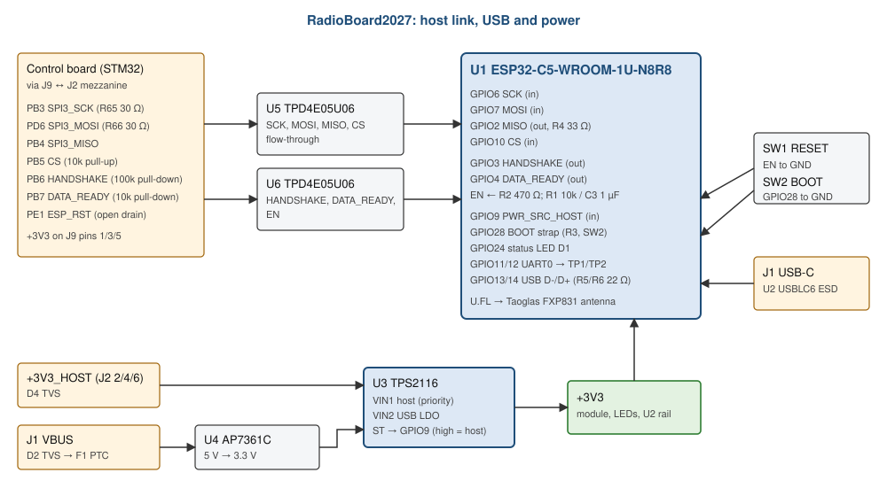

# RadioBoard2027 Firmware Specification

What the ESP32-C5 firmware on the radio daughterboard must do, and what the STM32 host on
ControlBoard2027 must match. Written for the firmware team.

| | |
|---|---|
| Board | RadioBoard2027 rev A, as ordered 2026-10-11 (PCB commit `79d0015`, schematic `61fa0d1`) |
| Module | Espressif ESP32-C5-WROOM-1U-N8R8: ESP32-C5, 2.4/5 GHz Wi-Fi 6, 8 MB flash, 8 MB PSRAM ([module datasheet](https://documentation.espressif.com/esp32-c5-wroom-1_wroom-1u_datasheet_en.pdf)) |
| Firmware | Espressif [esp-hosted-mcu](https://github.com/espressif/esp-hosted-mcu) co-processor, SPI full-duplex transport |
| Host | STM32H723 on ControlBoard2027, see [ControlBoard2027_SPEC.md](ControlBoard2027_SPEC.md) §5.2 |
| Date | 2026-10-13 |

**Source of truth.** Every pin and part here was taken from the schematic (netlist exported on
2026-10-13). If this document and the schematic disagree, the schematic wins. Design reasoning is
in `../RadioBoard2027/DESIGN_NOTES.md`, the hardware audit in [AUDIT_2026-10-13.md](AUDIT_2026-10-13.md).

**Contents**

1. [System overview](#1-system-overview)
2. [Module GPIO map](#2-module-gpio-map)
3. [ESP-Hosted configuration](#3-esp-hosted-configuration)
4. [Power and power-source handling](#4-power-and-power-source-handling)
5. [Host link pinout](#5-host-link-pinout)
6. [Boot, flashing and debug](#6-boot-flashing-and-debug)
7. [RF](#7-rf)
8. [Bring-up checklist](#8-bring-up-checklist)
9. [Hardware limitations firmware must handle](#9-hardware-limitations-firmware-must-handle)
10. [Hardware reference](#10-hardware-reference)

---

## 1. System overview

The radio board plugs face to face onto ControlBoard2027 J9 through a Samtec LSHM mezzanine
(J2, on the radio's underside). The STM32 talks to the ESP32-C5 over SPI using ESP-Hosted, so the
STM32 application gets Wi-Fi through the ESP-Hosted host API. The board can also run from its own
USB-C for flashing and debugging.

---

## 2. Module GPIO map

| GPIO | Module pad | Net | Direction | Board parts | Use |
|---|---|---|---|---|---|
| GPIO6 | 8 | ESP_SPI_SCK | In | ESD U5 | SPI clock from host (FSPI IO_MUX pin) |
| GPIO7 | 9 | ESP_SPI_MOSI | In | ESD U5 | SPI data from host (FSPI IO_MUX pin) |
| GPIO2 | 4 | ESP_SPI_MISO | Out | R4 33 Ω series, ESD U5 | SPI data to host (FSPI IO_MUX pin) |
| GPIO10 | 12 | ESP_SPI_CS | In | ESD U5 | SPI chip select from host, active low (FSPI IO_MUX pin) |
| GPIO3 | 5 | ESP_HANDSHAKE | Out | ESD U6 | ESP-Hosted handshake |
| GPIO4 | 17 | ESP_DATA_READY | Out | ESD U6 | ESP-Hosted data ready |
| EN | 3 | ESP_EN | In | R1 10k up, C3 1 µF, R2 470 Ω from host, SW1 | Reset, active low |
| GPIO9 | 11 | PWR_SRC_HOST | In | 10k pull-up (R13) on mux ST | High = powered by the control board |
| GPIO28 | 15 | BOOT | In (strap) | R3 10k up, SW2 to GND, C4 DNP | Boot mode strap |
| GPIO24 | 23 | STAT LED | Out | R8 1.5k → D1 green | Status LED, active high |
| GPIO11 | 25 | U0TXD | Out | R7 499 Ω → TP1 | UART0 TX (console) |
| GPIO12 | 24 | U0RXD | In | TP2 | UART0 RX |
| GPIO13 | 13 | USB D- | | R5 22 Ω, ESD U2 | USB Serial/JTAG |
| GPIO14 | 14 | USB D+ | | R6 22 Ω, ESD U2 | USB Serial/JTAG |
| GPIO15 | 19 | - | - | - | PSRAM chip select inside the N8R8: **do not use** |
| GPIO0, 1, 5, 8, 23, 25, 26, 27 | 6, 7, 16, 10, 21, 26, 27, 18 | - | - | - | Unconnected (no pad or header) |

Strapping pins on the C5: GPIO28 selects the boot mode (pulled up: SPI flash boot). GPIO27 has an
internal pull-up. GPIO2, GPIO3 and GPIO7 are also strapping pins but do not select the boot mode;
at reset the host's PB4 pull-up holds GPIO2 high and the host's 100k pull-down holds GPIO3 low.
Do not burn the JTAG-select eFuse (it would make GPIO7 a strap that matters).

---

## 3. ESP-Hosted configuration

Co-processor (ESP32-C5) build, `idf.py menuconfig` → ESP-Hosted transport:

| Setting | Value | Default for the C5 |
|---|---|---|
| Transport | SPI full duplex | |
| SPI controller | FSPI | same |
| SPI mode | **3** | 3 |
| CLK | **GPIO6** | 6 |
| MOSI | **GPIO7** | 7 |
| MISO | **GPIO2** | 2 |
| CS | **GPIO10** | 10 |
| Handshake | **GPIO3** | **1: must be changed** |
| Data ready | **GPIO4** | 4 |
| Reset pin | None (-1): the host resets the module through EN | -1 |
| Checksum | On | On |

Host (STM32) side, which must match: SPI3 master, mode 3, 8-bit, MSB first, hardware CRC off;
CS on PB5; HANDSHAKE on PB6 and DATA_READY on PB7 as rising-edge interrupts; reset on PE1 open
drain (low = reset). See the control board spec §5.2.

Link speed: bring up at 3-6 MHz, then raise. Lower the clock first if checksum errors appear. The
link is laid out as 50 Ω lines length-matched end to end (SCK/MOSI/CS within 0.2 mm across both
boards); MISO is ≈ 6 mm longer, which is negligible below 40 MHz.

---

## 4. Power and power-source handling

| Source | Path | GPIO9 PWR_SRC_HOST |
|---|---|---|
| Control board +3V3 (J2 pins 2/4/6) | TPS2116 mux U3, input 1 (priority) | High |
| Own USB-C VBUS | 3.3 V LDO U4 → U3 input 2 | Low |

The mux prefers the control board and blocks reverse current, so USB power never feeds the
control board.

Required handling:
- **While GPIO9 is low (running from USB with no host):** keep MISO (GPIO2), HANDSHAKE (GPIO3) and
  DATA_READY (GPIO4) as inputs, and ignore the SPI slave. The host is unpowered, its CS pull-up
  drags CS low and SCK/MOSI float, so the slave would see junk transactions.
- **On GPIO9 rising (host appeared):** expect a supply dip: the mux breaks before making and the
  module supply falls toward ≈ 2.6 V, below the module's 3.0 V minimum. Treat it as a possible
  brown-out; the host will also reset the module through EN.
- **On GPIO9 falling (host gone, USB present):** the module supply sags to ≈ 2.34 V before the mux
  switches. The module will likely brown out and reboot.
- Module peak current during Wi-Fi transmit is ≈ 313 mA (2.4 GHz) to ≈ 403 mA (5 GHz).

---

## 5. Host link pinout

J2 here mates face to face with ControlBoard2027 J9; radio pin p meets control pin p+1 (odd p) or
p-1 (even p).

| Radio J2 pin | Radio net | Control J9 pin | STM32 pin | Direction |
|---|---|---|---|---|
| 1 | ESP_EN | 2 | PE1 (open drain) | Host → radio, low = reset |
| 3 | ESP_DATA_READY | 4 | PB7 | Radio → host |
| 5 | ESP_HANDSHAKE | 6 | PB6 | Radio → host |
| 7 | ESP_SPI_MISO | 8 | PB4 (SPI3_MISO) | Radio → host |
| 11 | ESP_SPI_SCK | 12 | PB3 (SPI3_SCK, 30 Ω) | Host → radio |
| 15 | ESP_SPI_MOSI | 16 | PD6 (SPI3_MOSI, 30 Ω) | Host → radio |
| 19 | ESP_SPI_CS | 20 | PB5 | Host → radio |
| 2, 4, 6 | +3V3_HOST | 1, 3, 5 | +3V3 | Power to radio |
| 8, 9, 10, 12, 13, 14, 16, 17, 18, 20, shield | GND | 7, 9-11, 13-15, 17-19, shield | GND | |

Pulls on the link are on the control board: CS 10k up, HANDSHAKE 100k down, DATA_READY 10k down.
The EN pull-up (10k with 1 µF, ≈ 10 ms) is on this board.

---

## 6. Boot, flashing and debug

| Task | How |
|---|---|
| Flash over USB | Plug USB-C J1. The C5's native USB Serial/JTAG enumerates; `idf.py -p <port> flash` resets into download mode automatically |
| Force download mode | Hold **BOOT** (SW2), press and release **RESET** (SW1), release BOOT. Needed if the application disabled USB or reused GPIO13/14 |
| Console | USB Serial/JTAG, or UART0 on TP1 (TX, after 499 Ω) / TP2 (RX), 3.3 V. There is no GND test point beside them |
| JTAG debug | Over the same USB Serial/JTAG (OpenOCD) |
| Reset from the host | Host pulls EN low (PE1). The host cannot select download mode, so it cannot reflash the module through the ROM bootloader; use USB, or an OTA path in the firmware |
| Status | D1 green on GPIO24 (active high), meaning defined by firmware. D3 red = +3V3 present |

Keep GPIO13/GPIO14 for USB so flashing keeps working.

---

## 7. RF

- The module uses its U.FL connector with the Taoglas FXP831.07.0100C dual-band flex antenna
  (100 mm cable, mounted on the chassis). The module's ANT2 pad is unused.
- **The FXP831's 5 GHz peak gain (5.5-7.2 dBi) is above the 3.65 dBi the module was certified
  with.** Until this is resolved, either limit 5 GHz transmit power in firmware or run on 2.4 GHz
  only (the 2.4 GHz gain, 3.28 dBi, is within the certified 3.86 dBi).

---

## 8. Bring-up checklist

1. USB only: D3 lights, the module enumerates as USB Serial/JTAG, flash a test app, D1 blinks.
2. Read GPIO9: low on USB only.
3. Build esp-hosted-mcu with the settings in §3 (handshake GPIO3).
4. Plug onto the control board with the control board unpowered, then power the control board:
   GPIO9 goes high; the module may reset.
5. Host brings ESP-Hosted up at 3-6 MHz; check HANDSHAKE/DATA_READY activity and checksums.
6. Raise the SPI clock step by step.
7. Measure the module supply at C1 during 5 GHz transmit (must stay ≥ 3.0 V).

---

## 9. Hardware limitations firmware must handle

| Limitation | Firmware response |
|---|---|
| ESP-Hosted handshake default (GPIO1) differs from the board (GPIO3) | Set it in menuconfig (§3) |
| Supply dips below 3.0 V when the host power appears or disappears with USB attached | Expect resets; the host re-initialises the link after every power-source change |
| CS has no pull-up on this board: floats when unmated, low when the host is off | Ignore the SPI slave while GPIO9 is low |
| Antenna 5 GHz gain above the certified limit | Cap 5 GHz TX power or use 2.4 GHz |
| The board is held only by the mezzanine connector | Impacts can break the link; host should detect loss and reset the module |
| Host cannot enter the ROM download mode | Flash over USB, or implement OTA |

---

## 10. Hardware reference

| Ref | Part | Function | Datasheet |
|---|---|---|---|
| U1 | Espressif ESP32-C5-WROOM-1U-N8R8 | Wi-Fi co-processor | [WROOM-1U](https://documentation.espressif.com/esp32-c5-wroom-1_wroom-1u_datasheet_en.pdf) |
| U3 | TI TPS2116DRLR | Power mux (status on GPIO9) | [TPS2116](https://www.ti.com/lit/ds/symlink/tps2116.pdf) |
| U4 | Diodes AP7361C-33E | USB 3.3 V LDO | [AP7361C](https://www.diodes.com/assets/Datasheets/AP7361C.pdf) |
| U5, U6 | TI TPD4E05U06DQAR | ESD on the link lines | [TPD4E05U06](https://www.ti.com/lit/ds/symlink/tpd4e05u06.pdf) |
| U2 | ST USBLC6-2SC6 | USB ESD | [USBLC6-2](https://www.st.com/resource/en/datasheet/usblc6-2.pdf) |
| J2 | Samtec LSHM-110-02.5-L-DV-A-S-K-TR | Mezzanine to the control board | [LSHM](https://suddendocs.samtec.com/productspecs/lshm.pdf) |
| J1 | GCT USB4110-GF-A | USB-C | [USB4110](https://gct.co/files/drawings/usb4110.pdf) |
| ANT1 | Taoglas FXP831.07.0100C | Antenna (cable, chassis mounted) | [FXP831](https://cdn.taoglas.com/datasheets/FXP831.07.0100C.pdf) |

Board: 36 x 54 mm. Buttons RESET and BOOT on the east edge, USB-C on the west edge, antenna cable
leaves over the north edge. When mated, the board overhangs the control board's east edge.
